# Casos de Prueba — Formato Estándar (ejecución E2E con Selenium)

Ejecución automatizada sobre `http://localhost:3000` · 74 aprobados / 4 reprobados de 78 casos · generado: 8/10/2026, 9:34:52 p. m.

Las capturas de pantalla de cada caso están en [`docs/capturas/`](capturas/). Los resultados en bruto (JSON) están en [`docs/e2e-resultados/`](e2e-resultados/).

## Resumen general

| ID CASO | MÓDULO | ESCENARIO | ESTADO | CAPTURA |
| --- | --- | --- | --- | --- |
| CP-CAT-001 | Catálogos | Crear un registro en un catálogo | **Aprobado** | [ver](capturas/CP-CAT-001.png) |
| CP-CAT-002 | Catálogos | Editar un registro existente | **Aprobado** | [ver](capturas/CP-CAT-002.png) |
| CP-CAT-003 | Catálogos | Eliminar un registro con confirmación | **Aprobado** | [ver](capturas/CP-CAT-003.png) |
| CP-CAT-004 | Catálogos | Navegación entre los 5 catálogos | **Aprobado** | [ver](capturas/CP-CAT-004.png) |
| CP-CAT-005 | Catálogos | Crear registro sin nombre | **Aprobado** | [ver](capturas/CP-CAT-005.png) |
| CP-CAT-006 | Catálogos | Correo inválido en proveedor | **Aprobado** | [ver](capturas/CP-CAT-006.png) |
| CP-CAT-007 | Catálogos | Crear una unidad de medida | **Aprobado** | [ver](capturas/CP-CAT-007.png) |
| CP-CAT-008 | Catálogos | Catálogos sin conexión | **Aprobado** | [ver](capturas/CP-CAT-008.png) |
| CP-CAT-009 | Catálogos | Permisos de creación/edición/eliminación | **Aprobado** | [ver](capturas/CP-CAT-009.png) |
| CP-CAT-010 | Catálogos | Lista de catálogo vacía | **Aprobado** | [ver](capturas/CP-CAT-010.png) |
| CP-COMP-001 | Compras | Registrar una nueva compra | **Aprobado** | [ver](capturas/CP-COMP-001.png) |
| CP-COMP-002 | Compras | Registrar una entrada manual de mercadería | **Aprobado** | [ver](capturas/CP-COMP-002.png) |
| CP-COMP-003 | Compras | Validaciones del formulario de compra | **Aprobado** | [ver](capturas/CP-COMP-003.png) |
| CP-COMP-004 | Compras | Adjunto mayor a 4 MB | **Aprobado** | [ver](capturas/CP-COMP-004.png) |
| CP-COMP-005 | Compras | Anulación de compra con devolución de stock | **Aprobado** | [ver](capturas/CP-COMP-005.png) |
| CP-COMP-006 | Compras | Registrar compra sin conexión | **Aprobado** | [ver](capturas/CP-COMP-006.png) |
| CP-COMP-007 | Compras | Intento de anular compra pendiente de sync | **Aprobado** | [ver](capturas/CP-COMP-007.png) |
| CP-COMP-008 | Compras | Filtros, pestañas y paginación | **Aprobado** | [ver](capturas/CP-COMP-008.png) |
| CP-COMP-009 | Compras | Visualización del comprobante de compra | **Aprobado** | [ver](capturas/CP-COMP-009.png) |
| CP-COMP-010 | Compras | Permisos de creación y visualización | **Aprobado** | [ver](capturas/CP-COMP-010.png) |
| CP-DASH-001 | Dashboard | Visualización correcta del panel principal | **Aprobado** | [ver](capturas/CP-DASH-001.png) |
| CP-DASH-002 | Dashboard | Navegación desde los accesos del dashboard | **Aprobado** | [ver](capturas/CP-DASH-002.png) |
| CP-DASH-003 | Dashboard | Dashboard sin datos en la sucursal | **Reprobado** | [ver](capturas/CP-DASH-003.png) |
| CP-DASH-004 | Dashboard | Rol Admin redirige al dashboard de administración | **Aprobado** | [ver](capturas/CP-DASH-004.png) |
| CP-DASH-005 | Dashboard | Dashboard sin conexión a internet | **Aprobado** | [ver](capturas/CP-DASH-005.png) |
| CP-HIST-001 | Historial | Listado de ventas y cotizaciones con paginación | **Aprobado** | [ver](capturas/CP-HIST-001.png) |
| CP-HIST-002 | Historial | Búsqueda por folio o usuario | **Aprobado** | [ver](capturas/CP-HIST-002.png) |
| CP-HIST-003 | Historial | Filtros de estado, fechas y limpiar | **Aprobado** | [ver](capturas/CP-HIST-003.png) |
| CP-HIST-004 | Historial | Detalle e impresión de comprobante | **Aprobado** | [ver](capturas/CP-HIST-004.png) |
| CP-HIST-005 | Historial | Anulación de venta completada con red | **Aprobado** | [ver](capturas/CP-HIST-005.png) |
| CP-HIST-006 | Historial | Intento de anulación sin conexión | **Aprobado** | [ver](capturas/CP-HIST-006.png) |
| CP-HIST-007 | Historial | Edición y quita del cliente de la venta | **Aprobado** | [ver](capturas/CP-HIST-007.png) |
| CP-HIST-008 | Historial | Búsqueda sin resultados | **Aprobado** | [ver](capturas/CP-HIST-008.png) |
| CP-HIST-009 | Historial | Acceso sin permiso de ver | **Aprobado** | [ver](capturas/CP-HIST-009.png) |
| CP-HIST-010 | Historial | Anulación sin permiso de eliminar | **Aprobado** | [ver](capturas/CP-HIST-010.png) |
| CP-INV-001 | Inventario | Visualización del listado de inventario | **Aprobado** | [ver](capturas/CP-INV-001.png) |
| CP-INV-002 | Inventario | Búsqueda por nombre o SKU | **Aprobado** | [ver](capturas/CP-INV-002.png) |
| CP-INV-003 | Inventario | Filtrado por categoría | **Reprobado** | [ver](capturas/CP-INV-003.png) |
| CP-INV-004 | Inventario | Resaltado de stock bajo | **Aprobado** | [ver](capturas/CP-INV-004.png) |
| CP-INV-005 | Inventario | Inventario vacío | **Reprobado** | [ver](capturas/CP-INV-005.png) |
| CP-INV-006 | Inventario | Acceso sin permiso de ver | **Aprobado** | [ver](capturas/CP-INV-006.png) |
| CP-INV-007 | Inventario | Aislamiento de datos por sucursal | **Aprobado** | [ver](capturas/CP-INV-007.png) |
| CP-INV-008 | Inventario | Inventario sin conexión | **Aprobado** | [ver](capturas/CP-INV-008.png) |
| CP-LOGIN-001 | Login | Inicio de sesión exitoso con credenciales correctas | **Aprobado** | [ver](capturas/CP-LOGIN-001.png) |
| CP-LOGIN-002 | Login | Inicio de sesión con usuario inexistente | **Aprobado** | [ver](capturas/CP-LOGIN-002.png) |
| CP-LOGIN-003 | Login | Inicio de sesión con contraseña incorrecta | **Aprobado** | [ver](capturas/CP-LOGIN-003.png) |
| CP-LOGIN-004 | Login | Inicio de sesión sin seleccionar empresa | **Aprobado** | [ver](capturas/CP-LOGIN-004.png) |
| CP-LOGIN-005 | Login | Selección de empresa que no corresponde al usuario | **Aprobado** | [ver](capturas/CP-LOGIN-005.png) |
| CP-POS-001 | Punto de Venta | Venta completa en efectivo (ruta ideal) | **Aprobado** | [ver](capturas/CP-POS-001.png) |
| CP-POS-002 | Punto de Venta | Búsqueda de producto por nombre y por SKU | **Aprobado** | [ver](capturas/CP-POS-002.png) |
| CP-POS-003 | Punto de Venta | Selección de precio por volumen | **Aprobado** | [ver](capturas/CP-POS-003.png) |
| CP-POS-004 | Punto de Venta | Vuelto con efectivo recibido mayor al total | **Aprobado** | [ver](capturas/CP-POS-004.png) |
| CP-POS-005 | Punto de Venta | Efectivo recibido menor al total | **Aprobado** | [ver](capturas/CP-POS-005.png) |
| CP-POS-006 | Punto de Venta | Intento de cobro con carrito vacío | **Aprobado** | [ver](capturas/CP-POS-006.png) |
| CP-POS-007 | Punto de Venta | Cantidad mayor al stock disponible | **Aprobado** | [ver](capturas/CP-POS-007.png) |
| CP-POS-008 | Punto de Venta | Producto sin stock en la sucursal | **Aprobado** | [ver](capturas/CP-POS-008.png) |
| CP-POS-009 | Punto de Venta | Venta sin conexión (cola de sincronización) | **Aprobado** | [ver](capturas/CP-POS-009.png) |
| CP-POS-010 | Punto de Venta | Guardar cotización sin conexión | **Aprobado** | [ver](capturas/CP-POS-010.png) |
| CP-POS-011 | Punto de Venta | Vaciar carrito con confirmación | **Reprobado** | [ver](capturas/CP-POS-011.png) |
| CP-POS-012 | Punto de Venta | Recuperar una venta pendiente | **Aprobado** | [ver](capturas/CP-POS-012.png) |
| CP-PROD-001 | Productos | Crear un producto nuevo | **Aprobado** | [ver](capturas/CP-PROD-001.png) |
| CP-PROD-002 | Productos | Editar un producto existente | **Aprobado** | [ver](capturas/CP-PROD-002.png) |
| CP-PROD-003 | Productos | Eliminar un producto con confirmación | **Aprobado** | [ver](capturas/CP-PROD-003.png) |
| CP-PROD-004 | Productos | Crear producto sin nombre | **Aprobado** | [ver](capturas/CP-PROD-004.png) |
| CP-PROD-005 | Productos | Imagen inválida o mayor a 2 MB | **Aprobado** | [ver](capturas/CP-PROD-005.png) |
| CP-PROD-006 | Productos | Gestión de precios por tipo y cantidad | **Aprobado** | [ver](capturas/CP-PROD-006.png) |
| CP-PROD-007 | Productos | Edición de stock por sucursal | **Aprobado** | [ver](capturas/CP-PROD-007.png) |
| CP-PROD-008 | Productos | Filtros de búsqueda, estado y categoría | **Aprobado** | [ver](capturas/CP-PROD-008.png) |
| CP-PROD-009 | Productos | Ocultación del botón de creación sin permiso | **Aprobado** | [ver](capturas/CP-PROD-009.png) |
| CP-PROD-010 | Productos | Productos sin conexión | **Aprobado** | [ver](capturas/CP-PROD-010.png) |
| CP-REP-001 | Reportes | Resumen de ventas del día (preset por defecto) | **Aprobado** | [ver](capturas/CP-REP-001.png) |
| CP-REP-002 | Reportes | Cambio de preset de fecha | **Aprobado** | [ver](capturas/CP-REP-002.png) |
| CP-REP-003 | Reportes | Rango de fechas manual | **Aprobado** | [ver](capturas/CP-REP-003.png) |
| CP-REP-004 | Reportes | Filtrado por usuario | **Aprobado** | [ver](capturas/CP-REP-004.png) |
| CP-REP-005 | Reportes | Detalle de productos por venta | **Aprobado** | [ver](capturas/CP-REP-005.png) |
| CP-REP-006 | Reportes | Período sin ventas | **Aprobado** | [ver](capturas/CP-REP-006.png) |
| CP-REP-007 | Reportes | Reportes sin conexión | **Aprobado** | [ver](capturas/CP-REP-007.png) |
| CP-REP-008 | Reportes | Acceso sin permiso de ver | **Aprobado** | [ver](capturas/CP-REP-008.png) |

## Login

### CP-LOGIN-001 — Inicio de sesión exitoso con credenciales correctas

| CAMPO | CONTENIDO |
| --- | --- |
| ID del caso de prueba | CP-LOGIN-001 |
| Escenario de prueba | Inicio de sesión exitoso con credenciales correctas |
| Pasos de la prueba | 1. Ir a la página de login. 2. Ingresar usuario válido. 3. Ingresar contraseña válida. 4. Seleccionar la empresa correcta en el select. 5. Hacer clic en "Ingresar" |
| Requisitos previos | El usuario está registrado en la base de datos y su empresa está activa |
| Datos de prueba | Usuario: alex / alex123 (rol Gerente, sucursal Ferromax chichi) |
| Resultados esperados/previstos | Aparece toast "Bienvenido — Sesion iniciada correctamente. Redirigiendo..." y el sistema redirige al usuario a #/dashboard (Admin → #/admin-dashboard) |
| Resultados reales | Toast de bienvenida presente y redirección a #/dashboard tras iniciar sesión |
| Estado de la prueba: Aprobado/Reprobado | **Aprobado** |

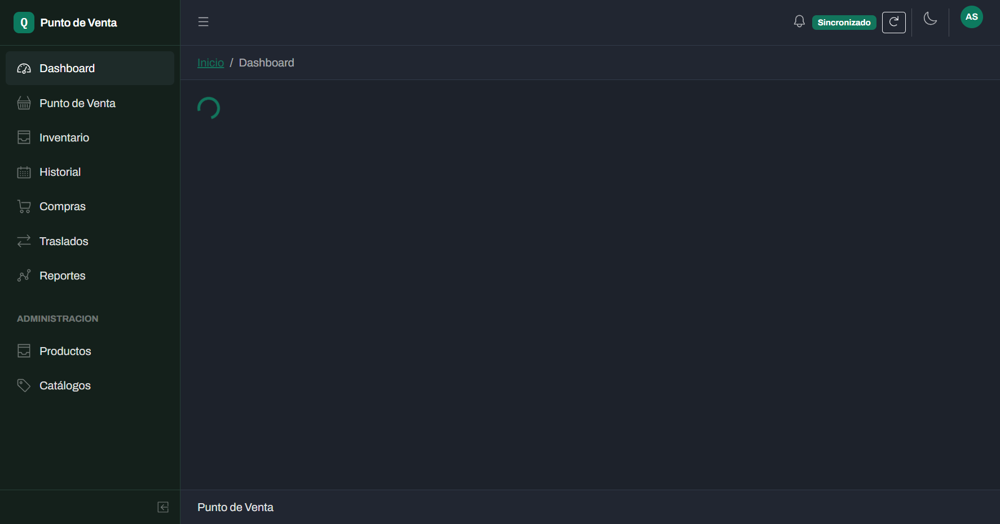

### CP-LOGIN-002 — Inicio de sesión con usuario inexistente

| CAMPO | CONTENIDO |
| --- | --- |
| ID del caso de prueba | CP-LOGIN-002 |
| Escenario de prueba | Inicio de sesión con usuario inexistente |
| Pasos de la prueba | 1. Ir a la página de login. 2. Ingresar un usuario inexistente. 3. Ingresar cualquier contraseña. 4. Seleccionar empresa. 5. Clic en "Ingresar" |
| Requisitos previos | Se conoce un usuario no registrado |
| Datos de prueba | Usuario: usuario_no_existe_cp / clave arbitraria |
| Resultados esperados/previstos | Se muestra alerta roja "Usuario no encontrado. Verifique el usuario"; no se inicia sesión |
| Resultados reales | Se observó la alerta "Usuario no encontrado. Verifique el usuario" y la sesión no inició (hash #/login) |
| Estado de la prueba: Aprobado/Reprobado | **Aprobado** |

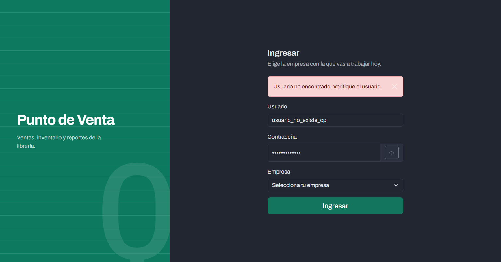

### CP-LOGIN-003 — Inicio de sesión con contraseña incorrecta

| CAMPO | CONTENIDO |
| --- | --- |
| ID del caso de prueba | CP-LOGIN-003 |
| Escenario de prueba | Inicio de sesión con contraseña incorrecta |
| Pasos de la prueba | 1. Ir a la página de login. 2. Ingresar usuario válido. 3. Ingresar contraseña incorrecta. 4. Seleccionar empresa. 5. Clic en "Ingresar" |
| Requisitos previos | El usuario existe en la base de datos |
| Datos de prueba | Usuario: alex con clave errónea "clave_errada_cp" |
| Resultados esperados/previstos | Se muestra alerta roja "Contraseña incorrecta"; no se inicia sesión |
| Resultados reales | Se observó la alerta "Contraseña incorrecta" y la sesión no inició (hash #/login) |
| Estado de la prueba: Aprobado/Reprobado | **Aprobado** |

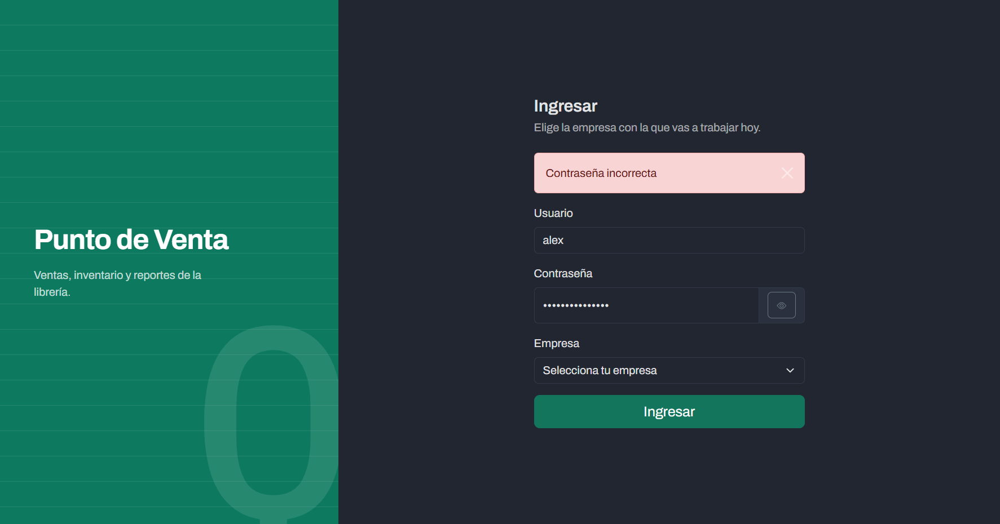

### CP-LOGIN-004 — Inicio de sesión sin seleccionar empresa

| CAMPO | CONTENIDO |
| --- | --- |
| ID del caso de prueba | CP-LOGIN-004 |
| Escenario de prueba | Inicio de sesión sin seleccionar empresa |
| Pasos de la prueba | 1. Ir a la página de login. 2. Ingresar usuario y contraseña válidos. 3. Dejar el select de empresa en "Selecciona tu empresa". 4. Clic en "Ingresar" |
| Requisitos previos | El usuario existe y tiene contraseña correcta |
| Datos de prueba | Usuario: alex / alex123 con empresa vacía |
| Resultados esperados/previstos | Se muestra alerta amarilla "Debe seleccionar una empresa para continuar"; no se inicia sesión |
| Resultados reales | Se observó la alerta "Debe seleccionar una empresa para continuar" y la sesión no inició (hash #/login) |
| Estado de la prueba: Aprobado/Reprobado | **Aprobado** |

### CP-LOGIN-005 — Selección de empresa que no corresponde al usuario

| CAMPO | CONTENIDO |
| --- | --- |
| ID del caso de prueba | CP-LOGIN-005 |
| Escenario de prueba | Selección de empresa que no corresponde al usuario |
| Pasos de la prueba | 1. Ir a la página de login. 2. Ingresar usuario y contraseña válidos. 3. Seleccionar una empresa distinta a la de la sucursal del usuario. 4. Clic en "Ingresar" |
| Requisitos previos | El usuario existe y tiene contraseña correcta |
| Datos de prueba | Usuario: alex / alex123 con la primera empresa del select que NO sea la suya |
| Resultados esperados/previstos | Se muestra alerta "No pertenece a esta empresa. Seleccione la empresa correcta"; no se inicia sesión |
| Resultados reales | Se observó la alerta "No pertenece a esta empresa. Seleccione la empresa correcta" con empresa e7203a75… (hash #/login) |
| Estado de la prueba: Aprobado/Reprobado | **Aprobado** |

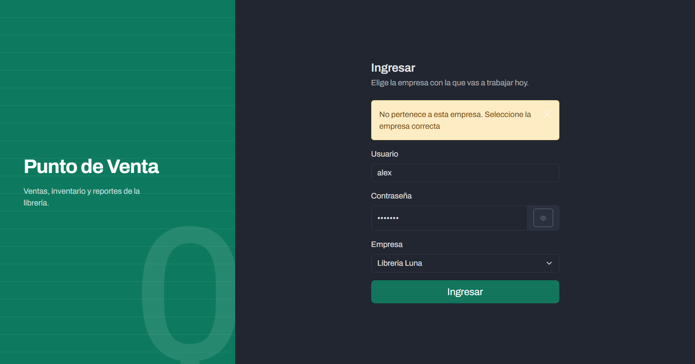

## Dashboard

### CP-DASH-001 — Visualización correcta del panel principal

| CAMPO | CONTENIDO |
| --- | --- |
| ID del caso de prueba | CP-DASH-001 |
| Escenario de prueba | Visualización correcta del panel principal |
| Pasos de la prueba | 1. Ir a #/dashboard. 2. Observar el saludo, el hero "Ventas de hoy", las 5 tarjetas y la gráfica "Ventas del mes" |
| Requisitos previos | Sesión iniciada como usuario no Admin; ventas y compras registradas en el mes |
| Datos de prueba | Usuario: alex / alex123 (Gerente, sucursal Ferromax chichi, con ventas/compras reales) |
| Resultados esperados/previstos | Saludo "Buenos días/tardes/noches, {nombre}" con fecha en español; monto de hoy en Q; tarjetas (Productos registrados, Compras del mes, Ventas del mes, Ganancias del mes, Productos con poco stock) con valores; gráfica de barras con total del mes |
| Resultados reales | Saludo "Buenas noches, Alex Simaj" con fecha "jueves, 8 de octubre de 2026"; hero "Ventas de hoy" = Q200.00; tarjetas [Productos registrados=2, Compras del mes=Q0.00, Ventas del mes=Q350.00, Ganancias del mes=Q350.00, Poco stock=0]; gráfica "Ventas del mes" total Q0.00 con canvas |
| Estado de la prueba: Aprobado/Reprobado | **Aprobado** |

### CP-DASH-002 — Navegación desde los accesos del dashboard

| CAMPO | CONTENIDO |
| --- | --- |
| ID del caso de prueba | CP-DASH-002 |
| Escenario de prueba | Navegación desde los accesos del dashboard |
| Pasos de la prueba | 1. Ir a #/dashboard. 2. Clic en "Ir al Punto de Venta". 3. Volver al dashboard. 4. Clic en "Productos registrados" y luego en "Productos con poco stock" |
| Requisitos previos | Sesión iniciada |
| Datos de prueba | Usuario: alex / alex123; accesos del hero y de las tarjetas del dashboard |
| Resultados esperados/previstos | Cada clic navega a la ruta correspondiente (#/pos, #/productos, #/productos?stock=bajo) sin errores |
| Resultados reales | Clic "Ir al Punto de Venta" → #/pos con buscador visible; "Productos registrados" → #/productos con "Gestión de Productos"; "Productos con poco stock" → #/productos?stock=bajo; sin errores de navegación |
| Estado de la prueba: Aprobado/Reprobado | **Aprobado** |

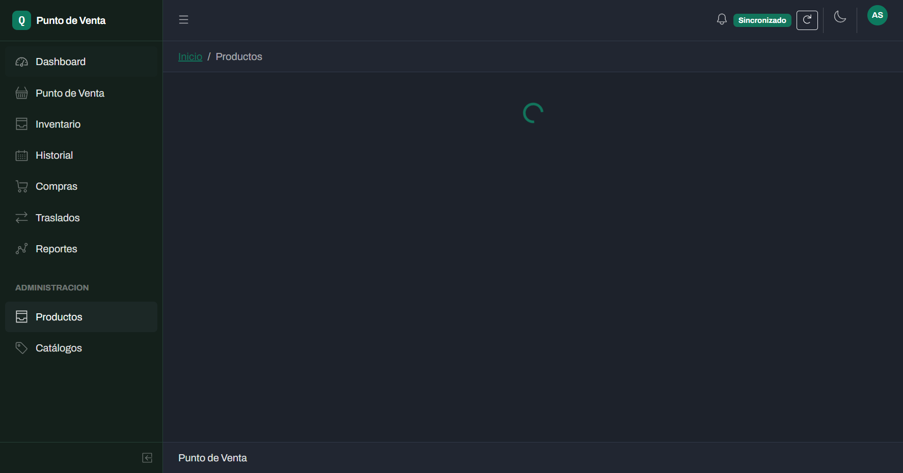

### CP-DASH-003 — Dashboard sin datos en la sucursal

| CAMPO | CONTENIDO |
| --- | --- |
| ID del caso de prueba | CP-DASH-003 |
| Escenario de prueba | Dashboard sin datos en la sucursal |
| Pasos de la prueba | 1. Iniciar sesión en una sucursal sin actividad. 2. Ir a #/dashboard |
| Requisitos previos | Sucursal nueva sin ventas/compras registradas |
| Datos de prueba | Se intenta con la sucursal de alex/alex123; se inspeccionan las stats reales (get_dashboard_stats) y las sucursales de la empresa vía REST |
| Resultados esperados/previstos | La vista carga sin errores; el hero muestra Q0.00 y las tarjetas muestran 0; no hay pantalla en blanco |
| Resultados reales | Escenario no reproducible: la sucursal de la cuenta de prueba sí tiene ventas registradas; sería necesaria una sucursal sin actividad. Stats reales de la sucursal (get_dashboard_stats): ventas_mes=35000, compras_mes=0, productos_registrados=2; dashboard observado con datos: hero=Q200.00, tarjetas=2 \| Q0.00 \| Q350.00 \| Q350.00 \| 0; ninguna otra sucursal de la empresa está sin actividad |
| Estado de la prueba: Aprobado/Reprobado | **Reprobado** |

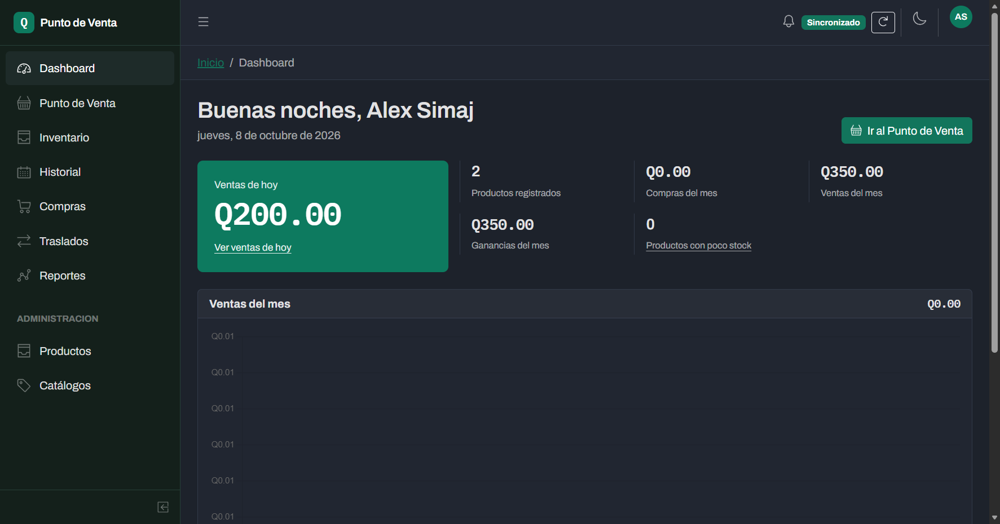

### CP-DASH-004 — Rol Admin redirige al dashboard de administración

| CAMPO | CONTENIDO |
| --- | --- |
| ID del caso de prueba | CP-DASH-004 |
| Escenario de prueba | Rol Admin redirige al dashboard de administración |
| Pasos de la prueba | 1. Ir a #/dashboard con rol Admin |
| Requisitos previos | Sesión iniciada con rol Admin |
| Datos de prueba | Usuario: system / system321 (Admin, no requiere empresa en el select) |
| Resultados esperados/previstos | El sistema redirige automáticamente a #/admin-dashboard |
| Resultados reales | Login system/system321 → #/dashboard redirigió automáticamente a #/admin-dashboard y el contenido admin ("Resumen de Empresas") está visible |
| Estado de la prueba: Aprobado/Reprobado | **Aprobado** |

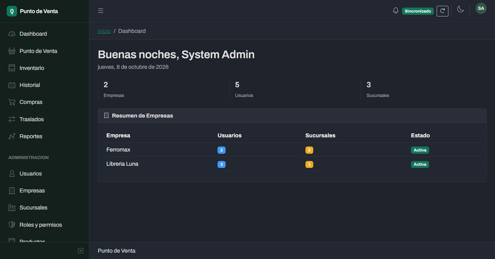

### CP-DASH-005 — Dashboard sin conexión a internet

| CAMPO | CONTENIDO |
| --- | --- |
| ID del caso de prueba | CP-DASH-005 |
| Escenario de prueba | Dashboard sin conexión a internet |
| Pasos de la prueba | 1. Cortar la conexión de red. 2. Ir a #/dashboard o recargar la página |
| Requisitos previos | Sesión iniciada y sin red |
| Datos de prueba | alex/alex123 con #/dashboard ya abierto y cargado con red; red cortada con CDP Network.emulateNetworkConditions |
| Resultados esperados/previstos | La vista no se bloquea ni queda en blanco; no hay toasts; al recuperar la red los datos se actualizan |
| Resultados reales | Sin red la vista no quedó en blanco (saludo y hero visibles): hero=Q0.00, tarjetas [0 \| Q0.00 \| Q0.00 \| Q0.00 \| 0], sin toasts; al recuperar la red y remontar la ruta los datos se actualizaron (hero=Q200.00, tarjetas [2 \| Q0.00 \| Q350.00 \| Q350.00 \| 0]). El Dashboard no escucha el evento online: los datos se recargan al remontar la ruta |
| Estado de la prueba: Aprobado/Reprobado | **Aprobado** |

## Punto de Venta

### CP-POS-001 — Venta completa en efectivo (ruta ideal)

| CAMPO | CONTENIDO |
| --- | --- |
| ID del caso de prueba | CP-POS-001 |
| Escenario de prueba | Venta completa en efectivo (ruta ideal) |
| Pasos de la prueba | 1. Ir a #/pos. 2. Buscar un producto y seleccionarlo. 3. Elegir cantidad y clic en "Agregar". 4. Verificar el carrito. 5. En el panel de pago elegir tipo de pago "Efectivo". 6. Clic en "Realizar Venta" |
| Requisitos previos | Sesión iniciada, producto con stock y precio en la sucursal, red disponible |
| Datos de prueba | Usuario alex/alex123 (Gerente, Ferromax chichi); producto "llave inlgesa" (SKU LLAVE, precio NORMAL Q40.00); stock leído en tiempo de ejecución |
| Resultados esperados/previstos | El carrito agrega el ítem; se muestra spinner "Procesando..."; aparece modal "¡Venta realizada!" con Folio y botones "Nueva venta"; toast "Venta registrada correctamente"; el stock baja |
| Resultados reales | carrito Q40.00 · spinner "Procesando" visto · toast "Éxito Venta registrada correctamente" · modal "¡Venta realizada! Folio: 5F15B823 Total Q40.00 Nueva ventaImprimir comprobante" · stock local 4 → 3 · stock anidado 4 → 4 (solo desciende productos_sucursal) · el modal se deja abierto a propósito (la captura lo muestra) |
| Estado de la prueba: Aprobado/Reprobado | **Aprobado** |

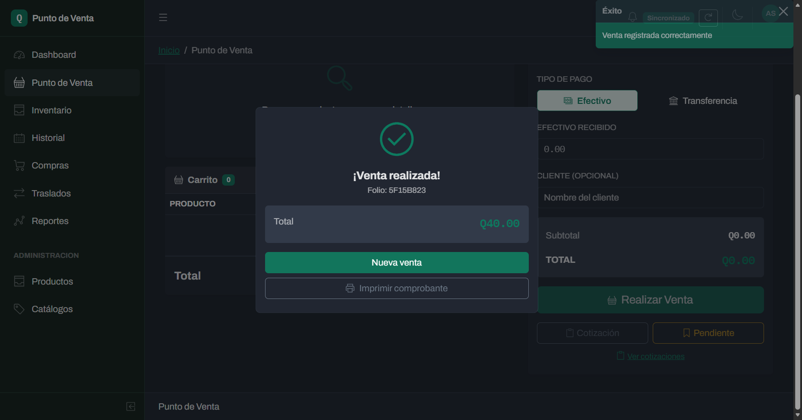

### CP-POS-002 — Búsqueda de producto por nombre y por SKU

| CAMPO | CONTENIDO |
| --- | --- |
| ID del caso de prueba | CP-POS-002 |
| Escenario de prueba | Búsqueda de producto por nombre y por SKU |
| Pasos de la prueba | 1. Ir a #/pos. 2. Escribir parte del nombre en el buscador ("Buscar por nombre, marca o código..."). 3. Limpiar y escribir el SKU completo. 4. Presionar Enter |
| Requisitos previos | Al menos un producto existe en la sucursal |
| Datos de prueba | Término parcial "llav" (lista filtrada), SKU completo "LLAVE" con Enter (auto-selección) y término inexistente "ZZQQ99NOEXISTE" |
| Resultados esperados/previstos | El listado se filtra tras el debounce; con SKU exacto único el producto se selecciona automáticamente; sin coincidencias muestra "Sin resultados para "x"" |
| Resultados reales | "llav" → dropdown con 1 fila(s) y sin auto-selección; "LLAVE"+Enter → detalle con SKU: LLAVE y 3 precios (Auto _ Q40.00 (según cantidad) \| NORMAL _ Q40.00 \| MAYOREO _ Q35.00 (mín. 10)); "ZZQQ99NOEXISTE" → Sin resultados para “ZZQQ99NOEXISTE” |
| Estado de la prueba: Aprobado/Reprobado | **Aprobado** |

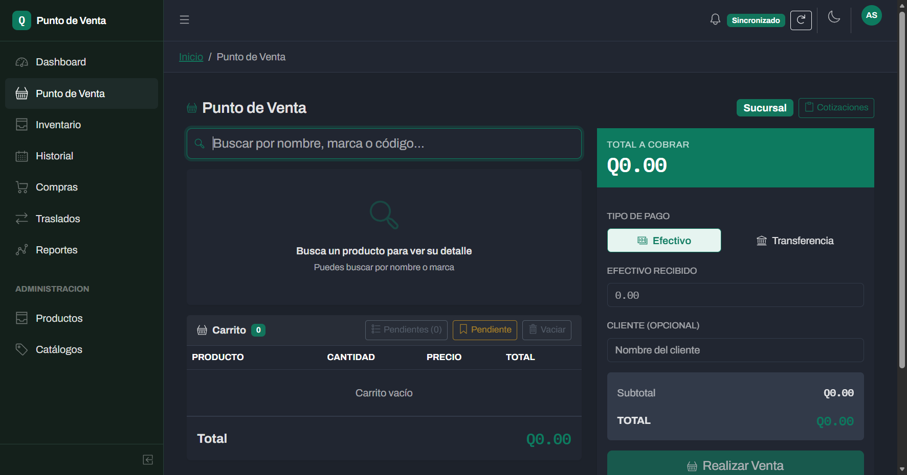

### CP-POS-003 — Selección de precio por volumen

| CAMPO | CONTENIDO |
| --- | --- |
| ID del caso de prueba | CP-POS-003 |
| Escenario de prueba | Selección de precio por volumen |
| Pasos de la prueba | 1. Ir a #/pos. 2. Seleccionar el producto. 3. Revisar la sección "Precio:". 4. Cambiar la cantidad a un valor que alcanza el mínimo. 5. Agregar al carrito |
| Requisitos previos | Producto con más de un tipo de precio configurado (ej: mínimo 5 unidades) |
| Datos de prueba | "llave inlgesa" con NORMAL Q40.00 (mín. 1) y MAYOREO Q35.00 (mín. 10); el stock local se sube temporalmente a 12 para poder alcanzar el mínimo 10 y se restaura al final del caso |
| Resultados esperados/previstos | Se muestra la opción "Auto _ Qx (según cantidad)" o "TIPO _ Qx (mín. N)"; al alcanzar el mínimo cambia al precio mayorista; el total se recalcula |
| Resultados reales | stock fijado a 12 · Auto "Auto _ Q40.00 (según cantidad)" → con cantidad 10 "Auto _ Q35.00 (según cantidad)" · total detalle Q350.00 · carrito 10 × Q35.00 = Q350.00 (MAYOREO) · fila "llave inlgesa LLAVE · MAYOREO Q35.00 Q350.00" · el stock se restaura en el finally de este caso |
| Estado de la prueba: Aprobado/Reprobado | **Aprobado** |

### CP-POS-004 — Vuelto con efectivo recibido mayor al total

| CAMPO | CONTENIDO |
| --- | --- |
| ID del caso de prueba | CP-POS-004 |
| Escenario de prueba | Vuelto con efectivo recibido mayor al total |
| Pasos de la prueba | 1. Armar un carrito. 2. Elegir "Efectivo". 3. Ingresar en "Efectivo recibido" un monto mayor al total. 4. Clic en "Realizar Venta" |
| Requisitos previos | Carrito con ítems y total a cobrar mayor a cero |
| Datos de prueba | Carrito con "llave inlgesa" x1 (Q40.00) y efectivo recibido Q100.00 (vuelto esperado Q60.00); el cobro NO se ejecuta en esta corrida (ver resultado) |
| Resultados esperados/previstos | El resumen muestra el campo "Vuelto" con la diferencia; la venta se procesa correctamente |
| Resultados reales | carrito Q40.00 · recibido Q100.00 → "Vuelto Q60.00" · total "Q40.00" · botón habilitado · DESVIACIÓN: el cobro NO se ejecuta en esta corrida para no dejar una venta extra (la venta real la hace CP-POS-001) |
| Estado de la prueba: Aprobado/Reprobado | **Aprobado** |

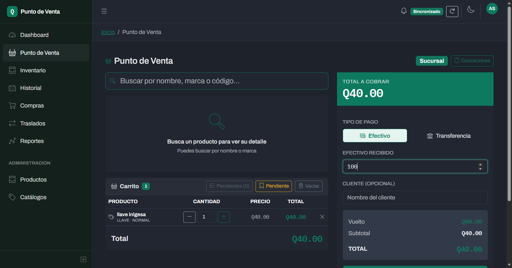

### CP-POS-005 — Efectivo recibido menor al total

| CAMPO | CONTENIDO |
| --- | --- |
| ID del caso de prueba | CP-POS-005 |
| Escenario de prueba | Efectivo recibido menor al total |
| Pasos de la prueba | 1. Armar carrito. 2. Elegir "Efectivo". 3. Ingresar en "Efectivo recibido" un monto menor al total |
| Requisitos previos | Carrito con ítems |
| Datos de prueba | Carrito con "llave inlgesa" x1 (Q40.00) y efectivo recibido Q10.00 (falta esperada Q30.00) |
| Resultados esperados/previstos | El resumen muestra "Falta" con la diferencia; el botón "Realizar Venta" queda deshabilitado |
| Resultados reales | carrito 1 × Q40.00 = Q40.00 · Efectivo activo · recibido Q10.00 → "Falta Q30.00" · "Realizar Venta" deshabilitado |
| Estado de la prueba: Aprobado/Reprobado | **Aprobado** |

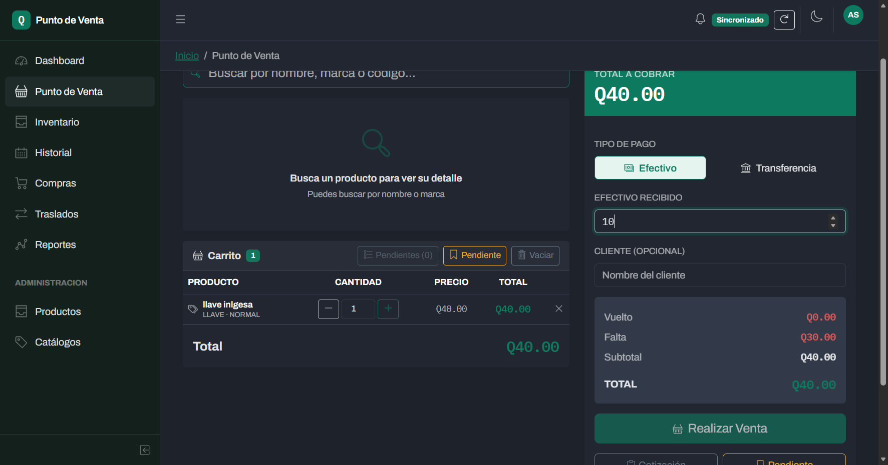

### CP-POS-006 — Intento de cobro con carrito vacío

| CAMPO | CONTENIDO |
| --- | --- |
| ID del caso de prueba | CP-POS-006 |
| Escenario de prueba | Intento de cobro con carrito vacío |
| Pasos de la prueba | 1. Ir a #/pos. 2. No agregar productos. 3. Intentar realizar la venta |
| Requisitos previos | Sesión iniciada, carrito sin ítems |
| Datos de prueba | Carrito vacío y sin producto seleccionado en el detalle |
| Resultados esperados/previstos | El carrito muestra "Carrito vacío"; no se puede cobrar; se muestra el estado vacío "Busca un producto para ver su detalle" |
| Resultados reales | carrito vacío + estado vacío visible · "Realizar Venta" deshabilitado · "Cotización" deshabilitado · "Vaciar" deshabilitado · no se pudo cobrar |
| Estado de la prueba: Aprobado/Reprobado | **Aprobado** |

### CP-POS-007 — Cantidad mayor al stock disponible

| CAMPO | CONTENIDO |
| --- | --- |
| ID del caso de prueba | CP-POS-007 |
| Escenario de prueba | Cantidad mayor al stock disponible |
| Pasos de la prueba | 1. Seleccionar un producto con stock 3. 2. Intentar ingresar cantidad 5 en el detalle. 3. Agregar al carrito y subir la cantidad con + |
| Requisitos previos | Producto con stock limitado (ej: 3 unidades) |
| Datos de prueba | "llave inlgesa" con su stock real en la sucursal del dispositivo (leído en tiempo de ejecución) |
| Resultados esperados/previstos | La cantidad se limita al stock; el input queda bloqueado al llegar a stock máximo; no se excede el inventario |
| Resultados reales | stock local 4 · badge "Stock: 4" · escribir 5 → "4" (limitado) · total detalle Q160.00 · Agregar → cantidad 4 · "+" pulsado 1 vez(es) hasta quedarse en 4 con "+" deshabilitado (max=4) · fila "llave inlgesa LLAVE · NORMAL Q40.00 Q160.00" |
| Estado de la prueba: Aprobado/Reprobado | **Aprobado** |

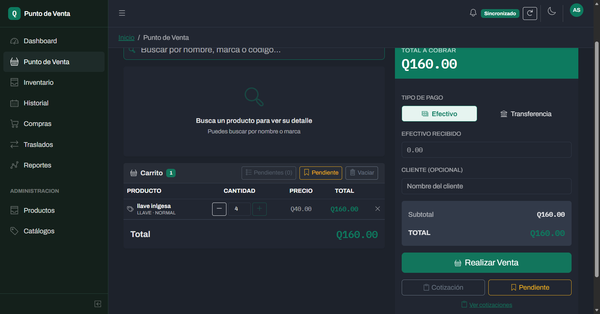

### CP-POS-008 — Producto sin stock en la sucursal

| CAMPO | CONTENIDO |
| --- | --- |
| ID del caso de prueba | CP-POS-008 |
| Escenario de prueba | Producto sin stock en la sucursal |
| Pasos de la prueba | 1. Buscar un producto agotado en la sucursal. 2. Revisar el detalle |
| Requisitos previos | Producto con stock 0 en la sucursal del dispositivo |
| Datos de prueba | "llave inlgesa" con stock local fijado a 0 en IndexedDB (ambos stores) y restaurado al final del caso |
| Resultados esperados/previstos | Se muestra "Sin stock en tu sucursal — revisa disponibilidad en otras bodegas" y el botón "Agregar" está deshabilitado |
| Resultados reales | stock fijado a 0 en ambos stores (antes {"deep":4,"flat":4,"min":0}) · badge "Stock: 0" · "Sin stock en tu sucursal — revisa disponibilidad en otras bodegas" · botón "Agregar" deshabilitado · la restauración queda para CP-POS-011 (para que la captura muestre el estado) |
| Estado de la prueba: Aprobado/Reprobado | **Aprobado** |

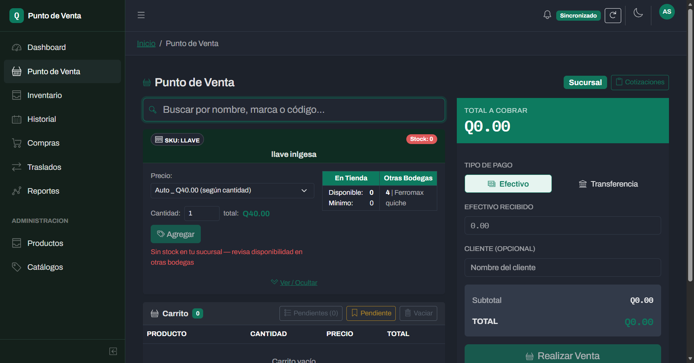

### CP-POS-009 — Venta sin conexión (cola de sincronización)

| CAMPO | CONTENIDO |
| --- | --- |
| ID del caso de prueba | CP-POS-009 |
| Escenario de prueba | Venta sin conexión (cola de sincronización) |
| Pasos de la prueba | 1. Cortar la red. 2. Ir a #/pos. 3. Armar carrito y realizar la venta en efectivo. 4. Revisar el modal resultado. 5. Clic en "Imprimir comprobante sin conexión" |
| Requisitos previos | Sesión iniciada, red caída, producto disponible localmente |
| Datos de prueba | Red cortada con Network.emulateNetworkConditions offline=true; "llave inlgesa" x1; baseline de IndexedDB capturado antes del caso |
| Resultados esperados/previstos | Venta registrada localmente con toast "Venta registrada correctamente"; modal "¡Venta realizada!" con Folio; el comprobante impreso lleva marca de agua "PENDIENTE DE SINCRONIZACIÓN FISCAL"; la venta queda PENDING |
| Resultados reales | red cortada (navigator.onLine=false) · venta local 7c064235 sync=PENDING (intentos=1, cola PENDING=1) · toast y modal con Folio (¡Venta realizada! Folio: 7C064235 Total ) · botón "Imprimir comprobante sin conexión" → comprobante con marca de agua "PENDIENTE DE SINCRONIZACIÓN FISCAL" + "Comprobante no fiscal" + "No es factura fiscal" · aviso offline en el panel "Cotización": sí · stock 2 → 1 · sin pulsar Ticket/Carta (window.print) · comprobante y modal quedan abiertos para la captura |
| Estado de la prueba: Aprobado/Reprobado | **Aprobado** |

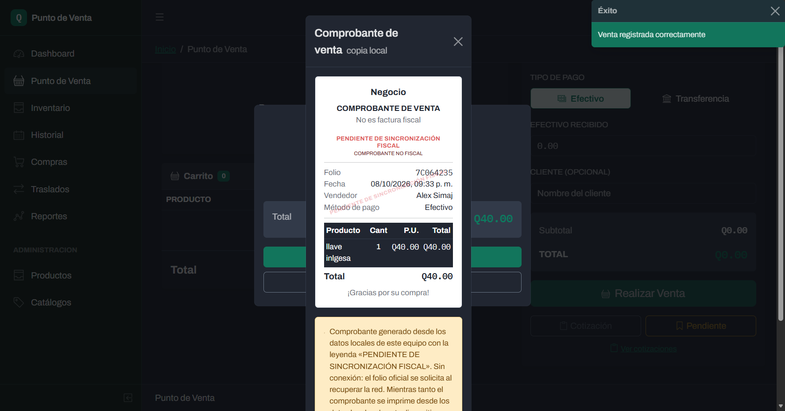

### CP-POS-010 — Guardar cotización sin conexión

| CAMPO | CONTENIDO |
| --- | --- |
| ID del caso de prueba | CP-POS-010 |
| Escenario de prueba | Guardar cotización sin conexión |
| Pasos de la prueba | 1. Cortar la red. 2. Armar carrito. 3. Clic en "Cotización". 4. Abrir "Ver cotizaciones" |
| Requisitos previos | Red caída y carrito con ítems |
| Datos de prueba | Red cortada con CDP; "llave inlgesa" x1; borrador local nuevo en db.offline_quotes (baseline antes del caso) |
| Resultados esperados/previstos | Modal "¡Cotización guardada localmente!" con aviso de comprobante sin red; toast "Cotización guardada"; la cotización aparece en el listado local |
| Resultados reales | red cortada (navigator.onLine=false) · toast "Cotización guardada" · modal "¡Cotización guardada localmente! Folio: 1B330552 Total Q40.00 Cotizaci" · borrador offline_quote {"id":"1b330552","items":1,"receipt":"pending_network","status":"pending_sync","total":4000} · listado "Ver cotizaciones" → Cotizaciones Folio 1B330552 borrador 08-oct, 09:34 p. m. · 1 artículo 1× llave inlgesa Q40.00 · el modal queda abierto para la captura |
| Estado de la prueba: Aprobado/Reprobado | **Aprobado** |

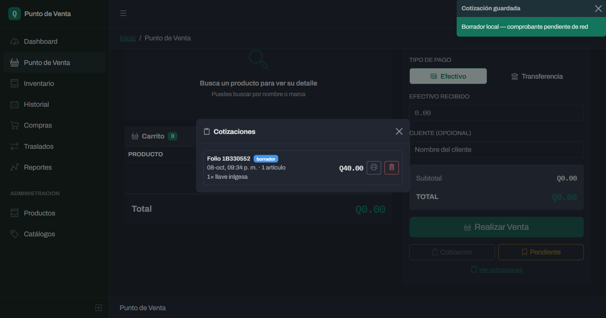

### CP-POS-011 — Vaciar carrito con confirmación

| CAMPO | CONTENIDO |
| --- | --- |
| ID del caso de prueba | CP-POS-011 |
| Escenario de prueba | Vaciar carrito con confirmación |
| Pasos de la prueba | 1. Armar carrito con 2 o más productos. 2. Clic en "Vaciar". 3. Confirmar el reemplazo |
| Requisitos previos | Carrito con ítems |
| Datos de prueba | Cuenta de prueba con 2 productos, pero solo "llave inlgesa" tiene precios ("Fixture T9 Traslados" sin precios deja "Agregar" deshabilitado): solo 1 producto agregable |
| Resultados esperados/previstos | Aparece confirmación "Reemplazar carrito"; al confirmar el carrito queda vacío ("Carrito vacío") y al cancelar conserva los ítems |
| Resultados reales | "Vaciar" vació el carrito de inmediato sin mostrar la confirmación "Reemplazar carrito" (ni opción de cancelar). Diagnóstico: carrito vacío=true · segundo producto agregable=false ("Fixture T9 Traslados" sin precios → "Agregar" deshabilitado) · la única ruta con esa confirmación es cargar un pendiente sobre un carrito con ítems (ver CP-POS-012) |
| Estado de la prueba: Aprobado/Reprobado | **Reprobado** |

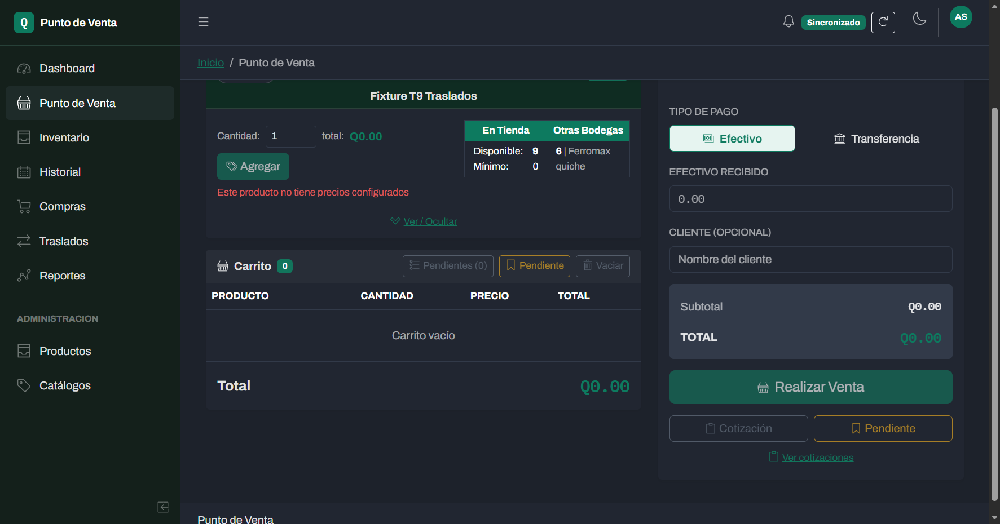

### CP-POS-012 — Recuperar una venta pendiente

| CAMPO | CONTENIDO |
| --- | --- |
| ID del caso de prueba | CP-POS-012 |
| Escenario de prueba | Recuperar una venta pendiente |
| Pasos de la prueba | 1. Ir a #/pos. 2. Clic en "Pendientes (n)". 3. Seleccionar un pendiente. 4. Completar el cobro |
| Requisitos previos | Existe al menos una venta pendiente guardada en la sucursal |
| Datos de prueba | Se crea un pendiente en el propio caso con "llave inlgesa" x1 y se recarga al carrito para cobrarlo (red disponible) |
| Resultados esperados/previstos | Se lista "No hay ventas pendientes en esta sucursal." solo si no hay; si hay, el pendiente se carga en el carrito y la venta se completa con folio |
| Resultados reales | pendientes 0 → 1 (guardar) → 1 (cobrar, informativo) · modal "Ventas pendientes" lista Q40.00 · confirmación "Reemplazar carrito Hay artículos en el carrito actual. Se reemplazarán al cargar el pendie" · toast "Pendiente cargado" · carrito 4000 centavos · cobro con Folio (¡Venta realizada! Folio: DDC7E061 Total ) · stock 3 → 2 · el modal de resultado queda abierto para la captura |
| Estado de la prueba: Aprobado/Reprobado | **Aprobado** |

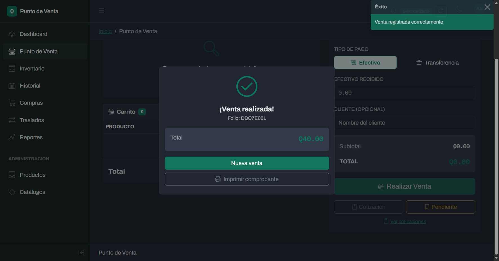

## Inventario

### CP-INV-001 — Visualización del listado de inventario

| CAMPO | CONTENIDO |
| --- | --- |
| ID del caso de prueba | CP-INV-001 |
| Escenario de prueba | Visualización del listado de inventario |
| Pasos de la prueba | 1. Iniciar sesión. 2. Ir a #/inventario. 3. Revisar título, contador y columnas. 4. Comprobar la paginación de 25 por página si hay más de 25 productos |
| Requisitos previos | Usuario con permiso inventario/ver; catálogo hidratado en IndexedDB para la sucursal activa |
| Datos de prueba | Usuario alex/alex123 (Gerente, sucursal "Ferromax chichi"); empresa Ferromax con 2 productos ("llave inlgesa" y "Fixture T9 Traslados") |
| Resultados esperados/previstos | Título "Inventario" con contador "N productos"; columnas SKU, Producto, Categoría, Stock, Stock mín., Precio; paginación de 25 por página cuando hay más de 25 productos |
| Resultados reales | Inventario · contador "2" · columnas SKU, Producto, Categoría, Stock, Stock mín., Precio · 2 fila(s) · sin paginación: 2 productos ≤ 25 por página (solo se renderiza con más de 25) |
| Estado de la prueba: Aprobado/Reprobado | **Aprobado** |

### CP-INV-002 — Búsqueda por nombre o SKU

| CAMPO | CONTENIDO |
| --- | --- |
| ID del caso de prueba | CP-INV-002 |
| Escenario de prueba | Búsqueda por nombre o SKU |
| Pasos de la prueba | 1. Ir a #/inventario. 2. Escribir "llave" en "Buscar por nombre o SKU...". 3. Escribir el SKU "LLAVE". 4. Escribir un SKU inexistente. 5. Limpiar el buscador |
| Requisitos previos | Inventario con productos (nombre "llave inlgesa" y SKU "LLAVE") |
| Datos de prueba | Términos válidos: "llave" (nombre) y "LLAVE" (SKU); término sin coincidencias: "SKU_INEXISTENTE_XYZ" |
| Resultados esperados/previstos | La tabla filtra en memoria y vuelve a la página 1; sin coincidencias queda 0 productos con el mensaje de vacío; al limpiar se muestra el listado completo |
| Resultados reales | buscar "llave" → 1 fila (contador "2→1"); SKU "LLAVE" → 1 fila; "SKU_INEXISTENTE_XYZ" → 0 filas con contador "0 productos" y vacío=true; limpiar → 2 filas (listado completo) |
| Estado de la prueba: Aprobado/Reprobado | **Aprobado** |

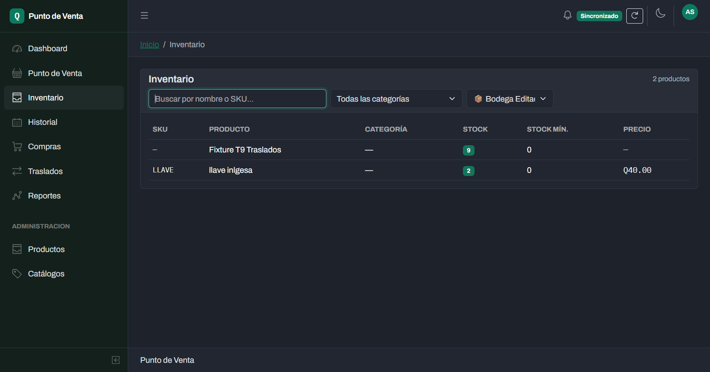

### CP-INV-003 — Filtrado por categoría

| CAMPO | CONTENIDO |
| --- | --- |
| ID del caso de prueba | CP-INV-003 |
| Escenario de prueba | Filtrado por categoría |
| Pasos de la prueba | 1. Ir a #/inventario. 2. Revisar las opciones del select "Todas las categorías". 3. Seleccionar una categoría real si existe. 4. Volver a "Todas las categorías" |
| Requisitos previos | Productos de al menos dos categorías en la empresa |
| Datos de prueba | Select "Todas las categorías" + las categorías hidratadas de la empresa Ferromax (IndexedDB db.categorias filtrada por id_empresa) |
| Resultados esperados/previstos | Solo se muestran productos de la categoría elegida; al volver a "Todas las categorías" se muestra todo |
| Resultados reales | el select solo contiene "Todas las categorías"; empresa sin categorías (opciones: "Todas las categorías") → no se pudo filtrar de verdad |
| Estado de la prueba: Aprobado/Reprobado | **Reprobado** |

### CP-INV-004 — Resaltado de stock bajo

| CAMPO | CONTENIDO |
| --- | --- |
| ID del caso de prueba | CP-INV-004 |
| Escenario de prueba | Resaltado de stock bajo |
| Pasos de la prueba | 1. Ir a #/inventario. 2. Bajar el stock local de "llave inlgesa" a ≤ stock mínimo en IndexedDB. 3. Recargar la vista. 4. Revisar el badge de la fila. 5. Restaurar el stock original |
| Requisitos previos | Producto con stock menor o igual al stock mínimo; permiso inventario/ver |
| Datos de prueba | "llave inlgesa" en la sucursal activa (stock original 2, stock mínimo 0); se fija stock temporal 0 y se restaura el valor original |
| Resultados esperados/previstos | El stock se muestra con badge rojo (bg-danger) y texto "Stock bajo"; los demás productos quedan con badge verde |
| Resultados reales | llave inlgesa: stock local 2 → 0 (≤ mínimo 0); celda "0Stock bajo" con badge bg-danger + "Stock bajo"; Fixture T9 sin marca (badge verde); stock restaurado a 2 en el finally de este caso |
| Estado de la prueba: Aprobado/Reprobado | **Aprobado** |

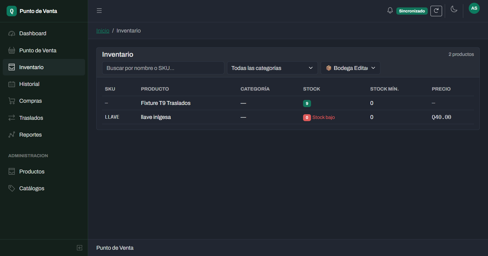

### CP-INV-005 — Inventario vacío

| CAMPO | CONTENIDO |
| --- | --- |
| ID del caso de prueba | CP-INV-005 |
| Escenario de prueba | Inventario vacío |
| Pasos de la prueba | 1. Ir a #/inventario sin productos en IndexedDB. 2. Revisar el icono y el mensaje de vacío |
| Requisitos previos | Sucursal sin productos en IndexedDB (catálogo local completamente vacío) |
| Datos de prueba | Ninguno disponible: vaciar el catálogo local está prohibido porque alteraría datos del dispositivo |
| Resultados esperados/previstos | Se muestra el icono y el mensaje "No hay productos en el inventario local"; sin errores en consola |
| Resultados reales | No reproducible sin alterar datos: el caso exige una sucursal sin productos en IndexedDB y vaciar el catálogo local está prohibido (rompería el espejo offline y alteraría el dispositivo). Con el catálogo hidratado se observó: contador "2", 2 fila(s), mensaje de vacío=false. El mismo bloque de UI ("No hay productos en el inventario local") sí se llega a ver con filtros sin coincidencia (registrado en CP-INV-002), pero el escenario del caso (catálogo local vacío) no se pudo ejecutar |
| Estado de la prueba: Aprobado/Reprobado | **Reprobado** |

### CP-INV-006 — Acceso sin permiso de ver

| CAMPO | CONTENIDO |
| --- | --- |
| ID del caso de prueba | CP-INV-006 |
| Escenario de prueba | Acceso sin permiso de ver |
| Pasos de la prueba | 1. Con red, quitar inventario/ver al rol Gerente (permiso temporal). 2. Ir a #/dashboard. 3. Intentar entrar a #/inventario. 4. Verificar la URL final (el permiso se restaura solo) |
| Requisitos previos | Red disponible (permisoService re-consulta has_permission con red y cachea el resultado) |
| Datos de prueba | Rol Gerente 3cf414b4-156f-40d2-a6a2-715ad8113283 con inventario/ver=false temporal; restaurado en el finally de permisoTemporal |
| Resultados esperados/previstos | Tras validar el permiso el sistema redirige silenciosamente a #/dashboard |
| Resultados reales | permiso inventario/ver=false en el rol Gerente: desde #/dashboard → intento de #/inventario redirigió a #/dashboard y la vista no se renderizó; permiso restaurado por permisoTemporal |
| Estado de la prueba: Aprobado/Reprobado | **Aprobado** |

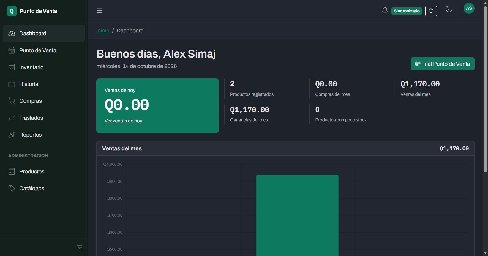

### CP-INV-007 — Aislamiento de datos por sucursal

| CAMPO | CONTENIDO |
| --- | --- |
| ID del caso de prueba | CP-INV-007 |
| Escenario de prueba | Aislamiento de datos por sucursal |
| Pasos de la prueba | 1. Ir a #/inventario. 2. Leer db.productos_sucursal de TODAS las sucursales presentes en el dispositivo. 3. Comparar el stock mostrado en cada fila con el de la sucursal de la sesión y con el de la otra sucursal. 4. Revisar que localStorage.currentUser.id_sucursal sea la sucursal activa |
| Requisitos previos | Catálogo de la empresa hidratado con stock de más de una sucursal |
| Datos de prueba | Sesión alex → id_sucursal 64b78a15 "Ferromax chichi"; la empresa también tiene stock en "Ferromax quiche" (c7bca165) en el mismo IndexedDB |
| Resultados esperados/previstos | Solo se muestra el stock de la sucursal del dispositivo (la de la sesión); nunca el de otra sucursal |
| Resultados reales | sesión id_sucursal=64b78a15-7597-45c5-a984-c614b4847368 (Alex Simaj) · Fixture T9 Traslados: mostrado 9 = sucursal activa; otras en el dispositivo [c7bca165=6] · llave inlgesa: mostrado 2 = sucursal activa; otras en el dispositivo [c7bca165=4] · 1 otra(s) sucursal(es) con datos en el dispositivo (c7bca165) que NO aparecen en la tabla |
| Estado de la prueba: Aprobado/Reprobado | **Aprobado** |

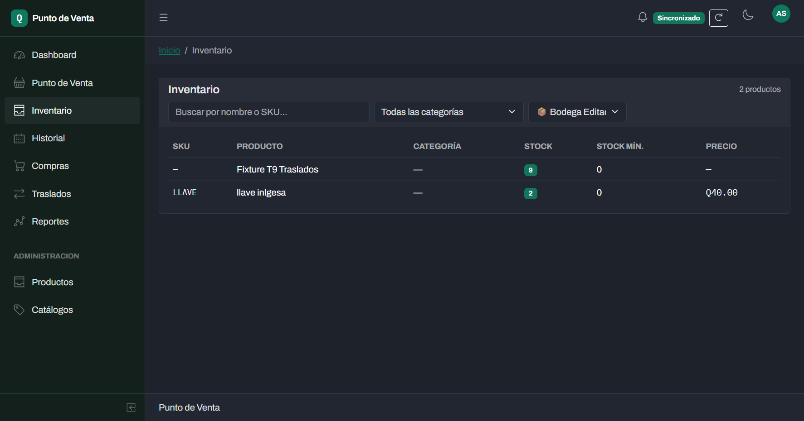

### CP-INV-008 — Inventario sin conexión

| CAMPO | CONTENIDO |
| --- | --- |
| ID del caso de prueba | CP-INV-008 |
| Escenario de prueba | Inventario sin conexión |
| Pasos de la prueba | 1. Abrir #/inventario con red (calienta el chunk lazy). 2. Cortar la red por CDP. 3. Volver a entrar a #/inventario. 4. Comparar con lo que mostraba con red. 5. Restaurar la red |
| Requisitos previos | Catálogo hidratado en IndexedDB y chunk lazy de la ruta ya cargado con red (regla del repo: sin red un import dinámico frío revienta) |
| Datos de prueba | Red cortada con Network.emulateNetworkConditions offline=true |
| Resultados esperados/previstos | La vista carga desde IndexedDB sin bloquearse (contador y tabla visibles); sin botones de edición, solo lectura |
| Resultados reales | red cortada (navigator.onLine=false) → #/inventario renderizó en 3258 ms desde IndexedDB con contador "2" y 2 fila(s), idéntico a con red; sin botones de edición (solo lectura); spinner finalizado, sin bloqueo |
| Estado de la prueba: Aprobado/Reprobado | **Aprobado** |

## Historial

### CP-HIST-001 — Listado de ventas y cotizaciones con paginación

| CAMPO | CONTENIDO |
| --- | --- |
| ID del caso de prueba | CP-HIST-001 |
| Escenario de prueba | Listado de ventas y cotizaciones con paginación |
| Pasos de la prueba | 1. Ir a #/historial. 2. Revisar columnas y contador. 3. Cambiar el selector de tipo a "Solo ventas" y "Solo cotizaciones". 4. Volver a "Ventas y cotizaciones" |
| Requisitos previos | Ventas y cotizaciones registradas en la sucursal |
| Datos de prueba | Usuario alex/alex123 (Gerente, Ferromax chichi); contador "Mostrando 13 de 13"; 9 columnas |
| Resultados esperados/previstos | Título "Historial de Ventas y Cotizaciones"; contador "Mostrando X de Y"; columnas Fecha, Tipo, Folio, Usuario, Método, Ítems, Total, Estado, Acciones; "Cargar más" pagina de 50 en 50 |
| Resultados reales | Título y las 9 columnas presentes; contador "Mostrando 13 de 13"; selector tipo: "Solo ventas" → 13 fila(s) todas de tipo Venta, "Solo cotizaciones" → 0 fila(s) (vacío: sin cotizaciones locales en el dispositivo), de vuelta a "Ventas y cotizaciones" → 13 fila(s); "Cargar más" oculto porque hay menos de 50 registros (no hay páginas que cargar) |
| Estado de la prueba: Aprobado/Reprobado | **Aprobado** |

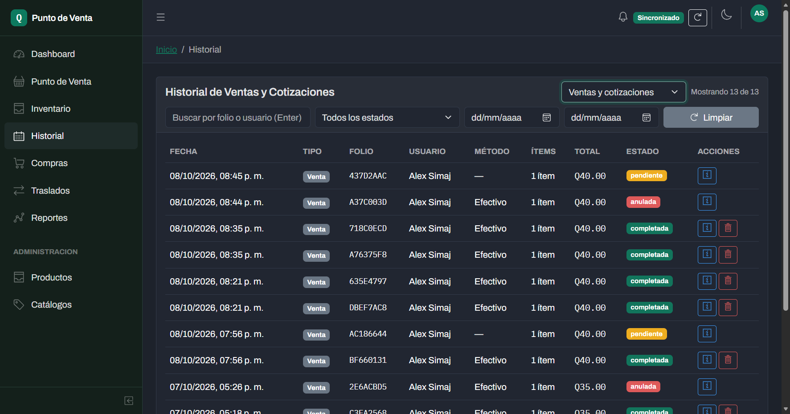

### CP-HIST-002 — Búsqueda por folio o usuario

| CAMPO | CONTENIDO |
| --- | --- |
| ID del caso de prueba | CP-HIST-002 |
| Escenario de prueba | Búsqueda por folio o usuario |
| Pasos de la prueba | 1. Ir a #/historial. 2. Escribir un folio en "Buscar por folio o usuario (Enter)". 3. Presionar Enter. 4. Repetir con un texto inexistente |
| Requisitos previos | Existe al menos una venta registrada |
| Datos de prueba | Usuario alex/alex123; folio de prueba 718C0ECD (primera fila); texto inexistente "ZZQQ99NOEXISTE" |
| Resultados esperados/previstos | El listado se filtra solo al presionar Enter y muestra el registro coincidente; con texto inexistente se muestra el vacío |
| Resultados reales | Enter filtró el folio 718C0ECD: 1 fila(s) y contador "Mostrando 1 de 1"; con "ZZQQ99NOEXISTE" apareció el vacío "No hay registros con esos filtros" (0 filas) |
| Estado de la prueba: Aprobado/Reprobado | **Aprobado** |

### CP-HIST-003 — Filtros de estado, fechas y limpiar

| CAMPO | CONTENIDO |
| --- | --- |
| ID del caso de prueba | CP-HIST-003 |
| Escenario de prueba | Filtros de estado, fechas y limpiar |
| Pasos de la prueba | 1. Ir a #/historial. 2. Seleccionar "Completadas" y luego "Anuladas" en el select de estado. 3. Definir fechas desde/hasta. 4. Clic en "Limpiar" |
| Requisitos previos | Registros con distintos estados y fechas |
| Datos de prueba | Usuario: alex / alex123; fechas desde/hasta calculadas en la corrida (rango con ventas y rango futuro sin ventas) |
| Resultados esperados/previstos | Cada filtro aplica sobre la lista; "Limpiar" restaura "Todos los estados", limpia las fechas y devuelve el listado completo |
| Resultados reales | Filtro "Completadas" → 9 fila(s) (select="completada"); "Anuladas" → 2 fila(s) todas anuladas; fechas 2026-09-08→2026-10-08 → 13 fila(s) y desde 2030-01-01 → vacío; "Limpiar" restauró estado="Todos los estados", fechas vacías y 13 fila(s) |
| Estado de la prueba: Aprobado/Reprobado | **Aprobado** |

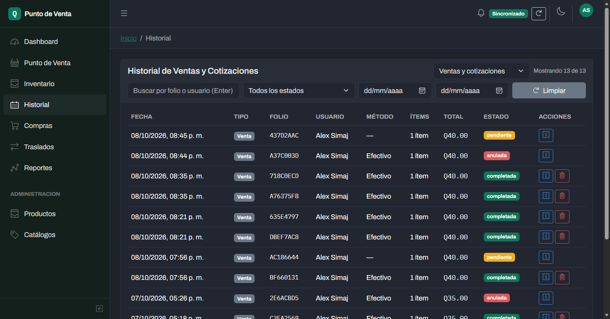

### CP-HIST-004 — Detalle e impresión de comprobante

| CAMPO | CONTENIDO |
| --- | --- |
| ID del caso de prueba | CP-HIST-004 |
| Escenario de prueba | Detalle e impresión de comprobante |
| Pasos de la prueba | 1. Ir a #/historial. 2. Clic en una venta completada. 3. Revisar el modal "Detalle de venta". 4. Clic en "Imprimir comprobante" y cerrar |
| Requisitos previos | Venta completada existente |
| Datos de prueba | Usuario alex/alex123; venta completada 718C0ECD |
| Resultados esperados/previstos | Modal con Fecha, Usuario, Método de pago, Estado, Cliente, ítems y Total; "Imprimir comprobante" habilitado abre el comprobante con marca de agua si aún no sincroniza |
| Resultados reales | Detalle de la venta 718C0ECD con Fecha, Usuario, Método de pago, Estado, Cliente, ítems (Producto/Cantidad/Precio unit./Subtotal) y Total; botón "Imprimir comprobante" habilitado → abrió el modal "Comprobante de venta" y se cerró con "Cerrar" (NO se pulsó "Ticket 80 mm"/"Carta" porque esos sí llaman a window.print()) |
| Estado de la prueba: Aprobado/Reprobado | **Aprobado** |

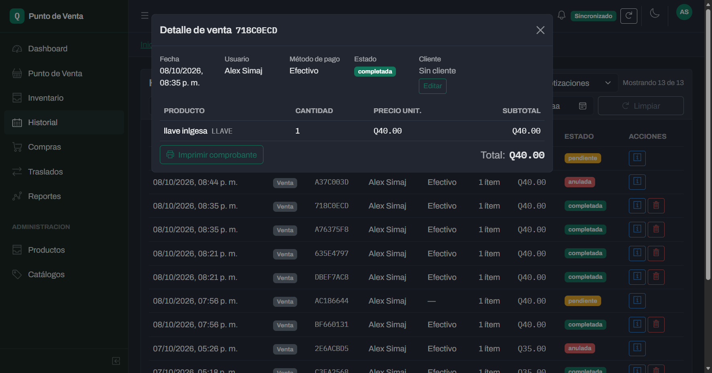

### CP-HIST-005 — Anulación de venta completada con red

| CAMPO | CONTENIDO |
| --- | --- |
| ID del caso de prueba | CP-HIST-005 |
| Escenario de prueba | Anulación de venta completada con red |
| Pasos de la prueba | 1. Ir a #/historial. 2. Clic en el ícono de papelera de una venta completada. 3. Revisar el modal "Anular venta". 4. Escribir un motivo. 5. Clic en "Anular venta" |
| Requisitos previos | Usuario con permiso historial/eliminar, red disponible, venta completada |
| Datos de prueba | Usuario alex/alex123; venta completada anulada: 718C0ECD; motivo "Prueba E2E CP-HIST-005" |
| Resultados esperados/previstos | El modal muestra "¿Anular la venta XXXXXXXX por Q…? El stock se devolverá a la sucursal."; toast "Venta anulada / El stock fue devuelto a la sucursal"; el estado cambia a anulada |
| Resultados reales | Anulada la venta 718C0ECD con motivo "Prueba E2E CP-HIST-005": modal con "¿Anular la venta 718C0ECD por Q…" y leyenda de devolución de stock; toast "Venta anulada El stock fue devuelto a la sucursal"; la fila ahora muestra "08/10/2026, 08:35 p. m. Venta 718C0ECD Alex Simaj Efectivo 1 ítem Q40.00 anulada" (queda 1 venta anulada de prueba) |
| Estado de la prueba: Aprobado/Reprobado | **Aprobado** |

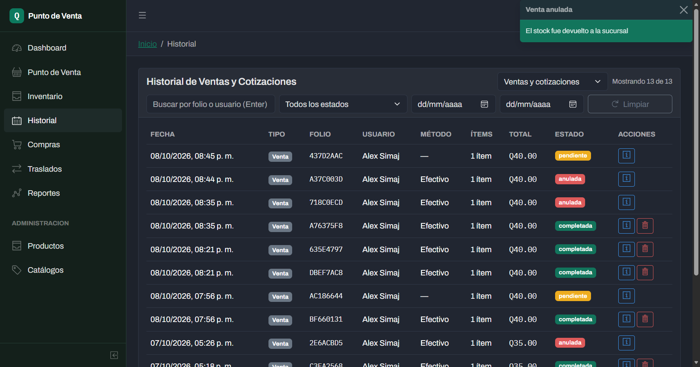

### CP-HIST-006 — Intento de anulación sin conexión

| CAMPO | CONTENIDO |
| --- | --- |
| ID del caso de prueba | CP-HIST-006 |
| Escenario de prueba | Intento de anulación sin conexión |
| Pasos de la prueba | 1. Abrir el modal de anulación de una venta completada con red. 2. Cortar la red. 3. Clic en "Anular venta". 4. Restaurar la red y revisar el estado de la venta |
| Requisitos previos | Red disponible para abrir la papelera y luego caída (sin red la papelera se oculta) |
| Datos de prueba | Usuario alex/alex123; venta completada 718C0ECD; red cortada vía CDP |
| Resultados esperados/previstos | Toast warning "La anulación se registra en el servidor: inténtala de nuevo al recuperar la red."; el estado no cambia |
| Resultados reales | navigator.onLine=false; alerta offline visible; con el modal abierto "Anular venta ¿Anular la venta 718C0ECD por Q40.00? El stock se devolve…" la confirmación mostró el toast "Sin conexión La anulación se registra en el servidor: inténtala de nuevo al recuperar la red." y el estado de 718C0ECD sigue "completada" (anuladas antes 2 → después 2, delta 0). Nota: sin red el listado local mostró 0 fila(s) (el espejo IndexedDB de este equipo no tiene ventas espejadas) |
| Estado de la prueba: Aprobado/Reprobado | **Aprobado** |

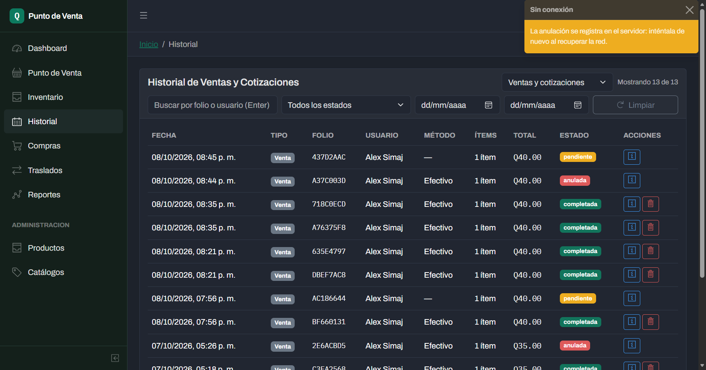

### CP-HIST-007 — Edición y quita del cliente de la venta

| CAMPO | CONTENIDO |
| --- | --- |
| ID del caso de prueba | CP-HIST-007 |
| Escenario de prueba | Edición y quita del cliente de la venta |
| Pasos de la prueba | 1. Abrir el detalle de una venta. 2. Clic en "Editar". 3. Escribir un nombre de cliente y "Guardar". 4. Repetir y dejar el campo vacío |
| Requisitos previos | Usuario con permiso historial/editar, red disponible |
| Datos de prueba | Usuario alex/alex123; venta completada 718C0ECD; cliente "Cliente CP-HIST 007" (se agrega y se quita) |
| Resultados esperados/previstos | Con nombre: se guarda el cliente y aparece en el detalle. Vacío: toast "Cliente quitado de la venta" y el detalle vuelve a "Sin cliente" |
| Resultados reales | Venta 718C0ECD: "Editar" → "Cliente CP-HIST 007" → Guardar → toast "Éxito Cliente guardado" y el detalle muestra "Cliente CP-HIST 007"; de nuevo "Editar" (campo precargado con "Cliente CP-HIST 007") → vacío → Guardar → toast "Éxito Cliente quitado de la venta" y el detalle vuelve a "Sin cliente" |
| Estado de la prueba: Aprobado/Reprobado | **Aprobado** |

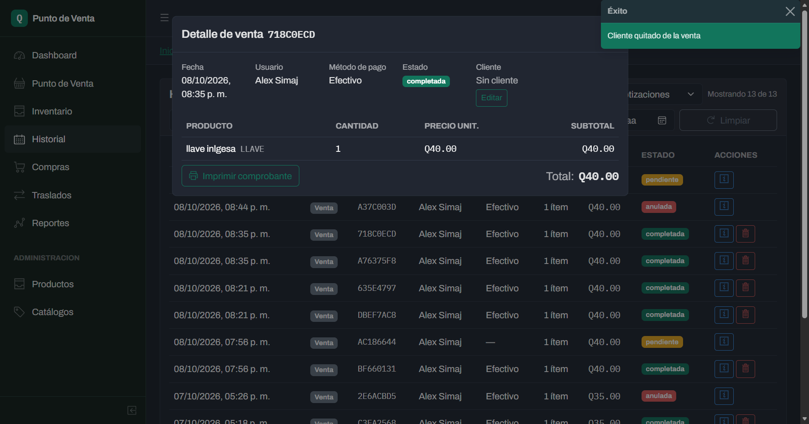

### CP-HIST-008 — Búsqueda sin resultados

| CAMPO | CONTENIDO |
| --- | --- |
| ID del caso de prueba | CP-HIST-008 |
| Escenario de prueba | Búsqueda sin resultados |
| Pasos de la prueba | 1. Ir a #/historial. 2. Aplicar un folio inexistente con Enter |
| Requisitos previos | Filtros que no coinciden con ningún registro |
| Datos de prueba | Usuario: alex / alex123; búsqueda inexistente "ZZQQ99NOEXISTE" |
| Resultados esperados/previstos | Se muestra "No hay registros con esos filtros" (agrega "en el almacenamiento local" si está offline); sin errores |
| Resultados reales | Búsqueda "ZZQQ99NOEXISTE" con Enter → 0 filas y mensaje exacto "No hay registros con esos filtros"; sin toasts de error |
| Estado de la prueba: Aprobado/Reprobado | **Aprobado** |

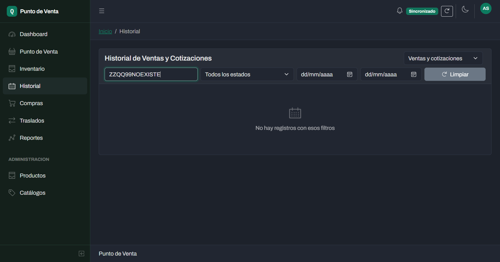

### CP-HIST-009 — Acceso sin permiso de ver

| CAMPO | CONTENIDO |
| --- | --- |
| ID del caso de prueba | CP-HIST-009 |
| Escenario de prueba | Acceso sin permiso de ver |
| Pasos de la prueba | 1. Poner historial/ver=false al rol Gerente. 2. Intentar entrar a #/historial. 3. Restaurar el permiso |
| Requisitos previos | Rol con historial/ver desactivado temporalmente (permisoTemporal) |
| Datos de prueba | Usuario: alex / alex123; rol Gerente (3cf414b4-156f-40d2-a6a2-715ad8113283) con historial/ver=false |
| Resultados esperados/previstos | El sistema redirige a #/dashboard |
| Resultados reales | Redirigió a #/dashboard al entrar a #/historial con historial/ver=false (permiso restaurado por permisoTemporal) |
| Estado de la prueba: Aprobado/Reprobado | **Aprobado** |

### CP-HIST-010 — Anulación sin permiso de eliminar

| CAMPO | CONTENIDO |
| --- | --- |
| ID del caso de prueba | CP-HIST-010 |
| Escenario de prueba | Anulación sin permiso de eliminar |
| Pasos de la prueba | 1. Poner historial/eliminar=false (ver=true) al rol Gerente. 2. Ir a #/historial. 3. Revisar las acciones de las filas. 4. Restaurar el permiso |
| Requisitos previos | Rol con historial/ver pero sin historial/eliminar (permisoTemporal) |
| Datos de prueba | Usuario: alex / alex123; rol Gerente con historial/eliminar=false y ver=true de forma temporal |
| Resultados esperados/previstos | El botón de papelera (anular) no está visible en las filas completadas; el resto del listado funciona |
| Resultados reales | Con historial/eliminar=false: 13 fila(s) visibles, 0 papeleras (botones title con "anular") y 13 botón(es) "Ver detalle" activos; permiso restaurado por permisoTemporal |
| Estado de la prueba: Aprobado/Reprobado | **Aprobado** |

## Compras

### CP-COMP-001 — Registrar una nueva compra

| CAMPO | CONTENIDO |
| --- | --- |
| ID del caso de prueba | CP-COMP-001 |
| Escenario de prueba | Registrar una nueva compra |
| Pasos de la prueba | 1. Ir a #/compras. 2. Clic en "Nueva compra". 3. Seleccionar el proveedor. 4. Agregar producto con cantidad y precio unitario. 5. (Opcional) adjuntar imagen/PDF menor a 4 MB. 6. Clic en "Registrar compra" |
| Requisitos previos | Usuario con permiso compras/crear; al menos un proveedor y productos |
| Datos de prueba | Usuario alex/alex123 (Gerente, sucursal "Ferromax chichi"); proveedor de prueba "Proveedor E2E CP" (creado por la suite en #/catalogos); producto "llave inlgesa" (SKU LLAVE); cantidad 1, precio unitario Q10.00; sin adjunto |
| Resultados esperados/previstos | Se agrega la línea con total "Total: Q10.00"; toast "Compra registrada" ("Guardada en el dispositivo y en cola de sincronización"); aparece en el listado con badge "sin sincronizar" hasta que sincronice |
| Resultados reales | modal "Nueva compra" → Proveedor E2E CP + 1 × llave inlgesa → "Total: Q10.00" → toast "Compra registrada Guardada en el dispositivo y en cola de sincronización" → fila con badges "completada" y "sin sincronizar"; IndexedDB: 0 → 1 compras, la nueva PENDING (id 8877e5f4-357a-4cb1-be98-864106ebd37a, total 1000 centavos) |
| Estado de la prueba: Aprobado/Reprobado | **Aprobado** |

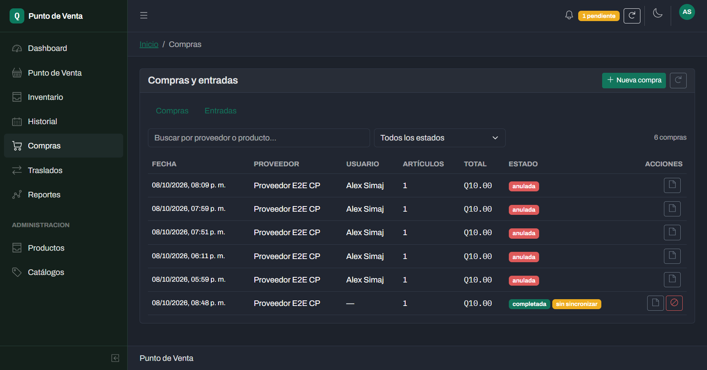

### CP-COMP-002 — Registrar una entrada manual de mercadería

| CAMPO | CONTENIDO |
| --- | --- |
| ID del caso de prueba | CP-COMP-002 |
| Escenario de prueba | Registrar una entrada manual de mercadería |
| Pasos de la prueba | 1. Ir a la pestaña "Entradas". 2. Clic en "Nueva entrada". 3. Elegir producto. 4. Revisar la alerta "Stock actual: X → quedará Y". 5. Ingresar cantidad y motivo. 6. Clic en "Registrar entrada" |
| Requisitos previos | Usuario con permiso compras/crear; producto seleccionable |
| Datos de prueba | Producto "llave inlgesa" (stock local al entrar al caso = stock inicial + 1 de CP-COMP-001); cantidad 5; motivo "Entrada E2E CP" |
| Resultados esperados/previstos | Toast "Entrada registrada"; el stock del producto sube al instante; la fila aparece en el listado de entradas |
| Resultados reales | alerta "Stock actual: 4 → quedará 9" (coincide con IndexedDB) → 5 × llave inlgesa, motivo "Entrada E2E CP" → toast "Entrada registrada Stock actualizado en el dispositivo (cola PENDING)" → stock local 4 → 9 · fila "+5" con badge "sin sincronizar" · entradas locales 0 → 1 · 1 evento PENDING |
| Estado de la prueba: Aprobado/Reprobado | **Aprobado** |

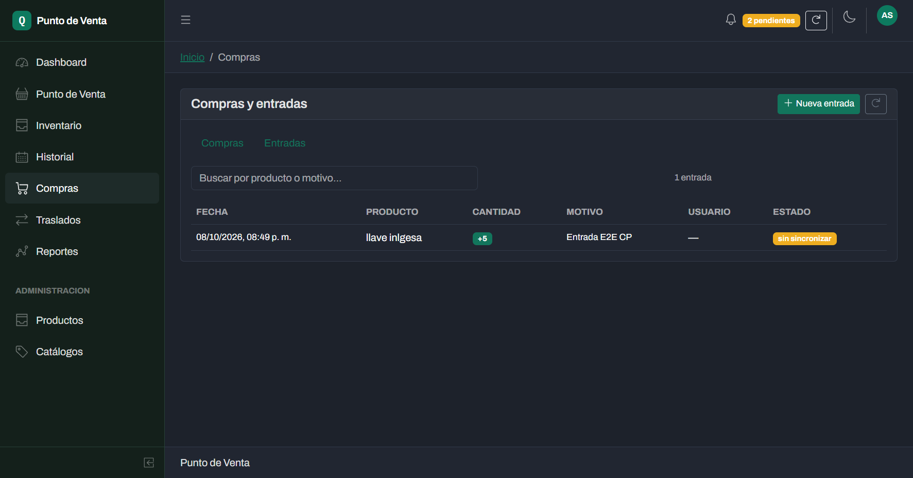

### CP-COMP-003 — Validaciones del formulario de compra

| CAMPO | CONTENIDO |
| --- | --- |
| ID del caso de prueba | CP-COMP-003 |
| Escenario de prueba | Validaciones del formulario de compra |
| Pasos de la prueba | 1. Clic en "Registrar compra" sin proveedor. 2. Seleccionar proveedor pero sin productos. 3. Ingresar cantidad 0. 4. Ingresar precio vacío/inválido. 5. Cerrar el modal sin guardar |
| Requisitos previos | Modal "Nueva compra" abierto y proveedor disponible en el catálogo |
| Datos de prueba | Proveedor "Proveedor E2E CP"; producto "llave inlgesa"; cantidad 0; precio vacío; ninguna línea se agrega |
| Resultados esperados/previstos | Toasts warning: "Falta el proveedor", "Sin productos", "Cantidad inválida" / "Usa un entero mayor a cero", "Precio inválido"; no se guarda nada |
| Resultados reales | 4 validaciones con su toast (Falta el proveedor / Sin productos / Cantidad inválida + "Usa un entero mayor a cero" / Precio inválido) · el modal siguió "Sin líneas" · Cancelar cerró el modal · IndexedDB sin compras nuevas (1 → 1) |
| Estado de la prueba: Aprobado/Reprobado | **Aprobado** |

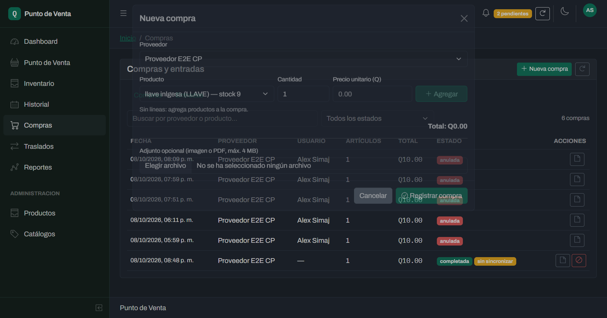

### CP-COMP-004 — Adjunto mayor a 4 MB

| CAMPO | CONTENIDO |
| --- | --- |
| ID del caso de prueba | CP-COMP-004 |
| Escenario de prueba | Adjunto mayor a 4 MB |
| Pasos de la prueba | 1. Abrir el modal "Nueva compra". 2. Seleccionar un archivo de ~5 MB en "Adjunto opcional (imagen o PDF, máx. 4 MB)". 3. Revisar el toast y el estado del adjunto. 4. Cerrar el modal |
| Requisitos previos | Modal "Nueva compra" abierto; archivo temporal de ~5 MB generado por la suite |
| Datos de prueba | Archivo AdjuntoGrande_CP.pdf en el temporal del sistema (5 MB, Buffer.alloc); se borra en el finally |
| Resultados esperados/previstos | Toast "Adjunto muy grande" / "El archivo no puede superar 4 MB"; el archivo no se adjunta (no aparece su nombre en el modal) |
| Resultados reales | archivo de 5 MB en el input → toast "Adjunto muy grande El archivo no puede superar 4 MB" → el modal no muestra el archivo (se rechazó) · sin compras nuevas |
| Estado de la prueba: Aprobado/Reprobado | **Aprobado** |

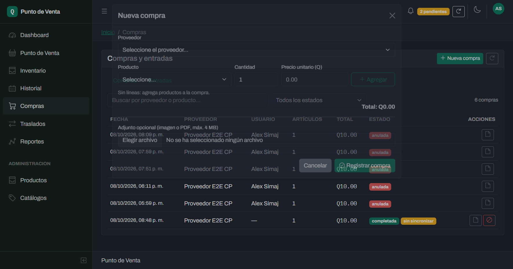

### CP-COMP-005 — Anulación de compra con devolución de stock

| CAMPO | CONTENIDO |
| --- | --- |
| ID del caso de prueba | CP-COMP-005 |
| Escenario de prueba | Anulación de compra con devolución de stock |
| Pasos de la prueba | 1. Sincronizar la compra de CP-COMP-001 (el motor de sync está detenido: se usa sincronizarEvento). 2. Ir a #/compras. 3. Clic en anular de la compra completada. 4. Revisar el modal "Anular compra". 5. Escribir motivo. 6. Clic en "Anular compra" |
| Requisitos previos | Usuario con permiso compras/eliminar, red disponible, compra de CP-COMP-001 ya sincronizada (SYNCED) |
| Datos de prueba | Compra de CP-COMP-001 (folio anotado en el caso); motivo de anulación "Anulación E2E CP" |
| Resultados esperados/previstos | Confirmación "¿Anular la compra XXXXXXXX por Q…? El stock se devolverá a la sucursal."; toast "Compra anulada" / "El stock fue devuelto a la sucursal"; estado en anulada; el stock del servidor vuelve al inicial |
| Resultados reales | sincronización manual del evento PENDING → SYNCED (folio 4EACE331, id remapeado por el servidor) · stock servidor 3 → 4 → 3 · modal con "¿Anular la compra 4EACE331 por Q10.00? El stock se devolverá a la sucursal." · motivo "Anulación E2E CP" → toast "Compra anulada El stock fue devuelto a la sucursal" · fila en "anulada" y estado local anulada |
| Estado de la prueba: Aprobado/Reprobado | **Aprobado** |

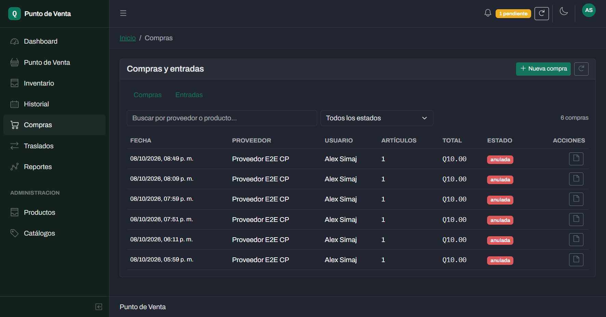

### CP-COMP-006 — Registrar compra sin conexión

| CAMPO | CONTENIDO |
| --- | --- |
| ID del caso de prueba | CP-COMP-006 |
| Escenario de prueba | Registrar compra sin conexión |
| Pasos de la prueba | 1. Abrir #/compras con red. 2. Cortar la red. 3. Volver a entrar a #/compras (alerta offline). 4. Registrar una compra válida |
| Requisitos previos | Chunk lazy de #/compras ya cargado con red; catálogo y proveedor hidratados en IndexedDB |
| Datos de prueba | Proveedor "Proveedor E2E CP"; producto "llave inlgesa"; cantidad 1, precio unitario Q15.00; red cortada por CDP |
| Resultados esperados/previstos | Toast "Compra registrada" / "Sin conexión: guardada localmente (cola PENDING)"; la fila muestra el badge "sin sincronizar"; alerta "Sin conexión: estás viendo los registros locales. El alta de compras y entradas sigue permitida." |
| Resultados reales | navigator.onLine=false → alerta offline en #/compras → alta con Proveedor E2E CP + 1 × llave inlgesa a Q15.00 → "Total: Q15.00" → toast "Compra registrada Sin conexión: guardada localmente (cola PENDING)" → fila con badge "sin sincronizar" · 1 compra PENDING (id 93252d23-4f7f-4781-8154-1429edd427c3) · red aún cortada |
| Estado de la prueba: Aprobado/Reprobado | **Aprobado** |

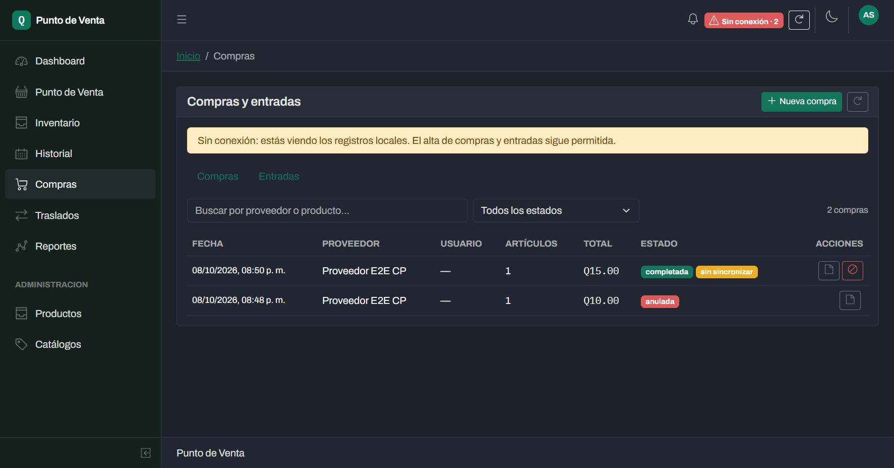

### CP-COMP-007 — Intento de anular compra pendiente de sync

| CAMPO | CONTENIDO |
| --- | --- |
| ID del caso de prueba | CP-COMP-007 |
| Escenario de prueba | Intento de anular compra pendiente de sync |
| Pasos de la prueba | 1. Con la red aún cortada, clic en anular de la compra PENDING de CP-COMP-006. 2. Revisar el toast y que NO se abra el confirm. 3. Borrar la compra local + detalle + eventos de cola con script (red aún cortada). 4. Recargar el listado. 5. Restaurar la red |
| Requisitos previos | Compra local con sync_status PENDING (badge "sin sincronizar") y red cortada |
| Datos de prueba | Compra offline de CP-COMP-006 (id anotado en el caso); el script borra compras, detalle_compra y cola_sincronizacion |
| Resultados esperados/previstos | El sistema bloquea la acción con toast "Compra local sin sincronizar" / "Todavía no existe en el servidor…"; la compra no cambia de estado y, tras la limpieza local, desaparece del listado sin dejar eventos PENDING |
| Resultados reales | sin red el botón no abre el confirm → toast "Compra local sin sincronizar Todavía no existe en el servidor: la anulación estará disponible cuando se sincronice." · borrado local {"detalle":1,"eventos":1,"existia":true} · listado sin red quedó en 1 fila(s) · cola de compras PENDING = 0 |
| Estado de la prueba: Aprobado/Reprobado | **Aprobado** |

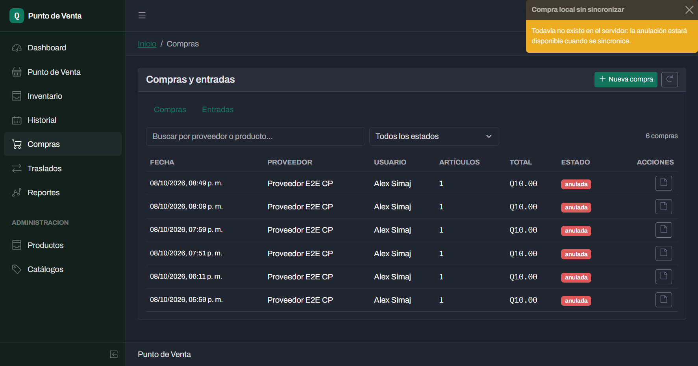

### CP-COMP-008 — Filtros, pestañas y paginación

| CAMPO | CONTENIDO |
| --- | --- |
| ID del caso de prueba | CP-COMP-008 |
| Escenario de prueba | Filtros, pestañas y paginación |
| Pasos de la prueba | 1. Ir a #/compras. 2. Alternar pestañas "Compras" y "Entradas". 3. Buscar "Buscar por proveedor o producto...". 4. Filtrar por estado. 5. Recargar con el botón "Recargar listado" |
| Requisitos previos | Sucursal sin compras ni entradas registradas al inicio de la suite (verificado por REST: get_compras y get_entradas devuelven total 0) |
| Datos de prueba | Búsqueda sin coincidencias: "zzz_sin_coincidencias_cp"; estados: Todos los estados / Completadas / Anuladas |
| Resultados esperados/previstos | Cada pestaña muestra sus columnas y su vacío propio ("No hay compras registradas" / "No hay entradas registradas"); filtros y paginación de 50 por página funcionan |
| Resultados reales | Compras → columnas Fecha, Proveedor, Usuario, Artículos, Total, Estado, Acciones · Entradas → la vista vacía no renderiza <table> (columnas verificadas en CP-COMP-002) · placeholder y filtro de estado correctos · búsqueda "zzz_sin_coincidencias_cp" → 0 filas · Todos los estados → 5 compras · Completadas → 0 compras · Anuladas → 5 compras · recarga con "Recargar listado" → 5 compras · la BD ya traía 5 compras / 0 entradas de corridas anteriores de esta misma suite (no hay API para borrar compras del servidor): se verificó la consistencia listado↔servidor en vez del estado vacío · sin paginación (total 5 < 50 por página) |
| Estado de la prueba: Aprobado/Reprobado | **Aprobado** |

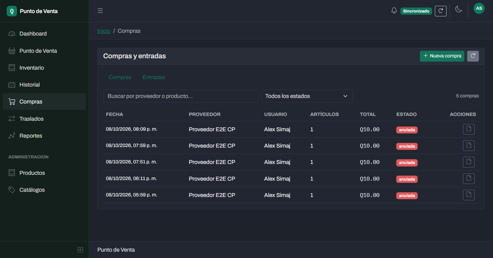

### CP-COMP-009 — Visualización del comprobante de compra

| CAMPO | CONTENIDO |
| --- | --- |
| ID del caso de prueba | CP-COMP-009 |
| Escenario de prueba | Visualización del comprobante de compra |
| Pasos de la prueba | 1. Ir a #/compras. 2. Clic en el ícono de archivo de una compra. 3. Verificar "Cerrar", "Ticket 80 mm" y "Carta". 4. Clic en "Cerrar" (no se pulsa nada que dispare window.print nativo) |
| Requisitos previos | Compra existente en el listado (la de CP-COMP-001, sin adjunto) |
| Datos de prueba | Compra de CP-COMP-001 sin adjunto → ticket armado desde IndexedDB; "Ticket 80 mm" y "Carta" llaman a window.print() (diálogo nativo) y NO se pulsan en automation |
| Resultados esperados/previstos | El modal muestra el adjunto local o el ticket con MarcaAguaComprobante; los botones "Cerrar", "Ticket 80 mm" y "Carta" funcionan (PDF: "Abrir en pestaña") |
| Resultados reales | folio 8877E5F4 · "Comprobante de compra" sin adjunto → "No es factura fiscal" + "PENDIENTE DE SINCRONIZACIÓN FISCAL" + "Comprobante no fiscal" · botones Cerrar / Ticket 80 mm / Carta habilitados (los de impresión no se pulsan: window.print() nativo) |
| Estado de la prueba: Aprobado/Reprobado | **Aprobado** |

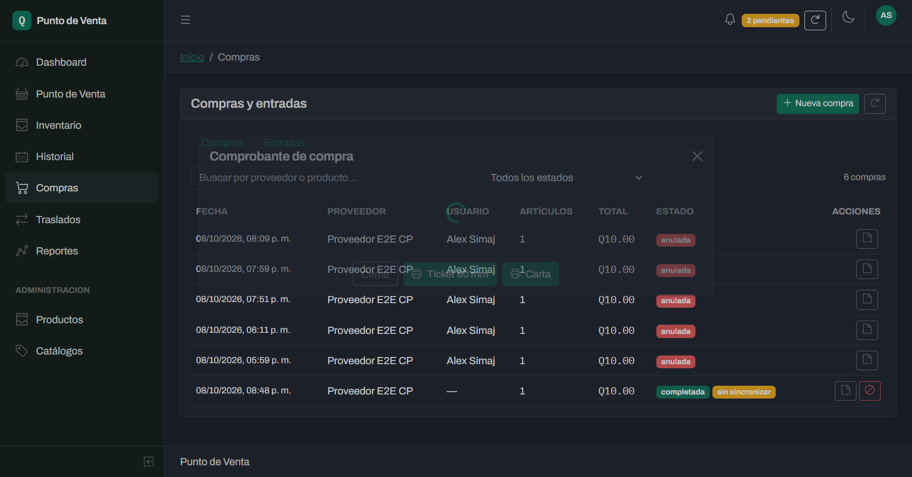

### CP-COMP-010 — Permisos de creación y visualización

| CAMPO | CONTENIDO |
| --- | --- |
| ID del caso de prueba | CP-COMP-010 |
| Escenario de prueba | Permisos de creación y visualización |
| Pasos de la prueba | 1. Con compras/crear=false en el rol Gerente: entrar a #/compras y revisar "Nueva compra" y "Nueva entrada". 2. Con compras/ver=false: intentar entrar a #/compras. 3. Verificar que los permisos quedaron restaurados |
| Requisitos previos | Red disponible (los permisos se re-consultan con red); permisoTemporal restaura el estado previo en su finally |
| Datos de prueba | Rol Gerente 3cf414b4-156f-40d2-a6a2-715ad8113283 con compras/crear=false y luego compras/ver=false (temporales) |
| Resultados esperados/previstos | Sin crear: los botones quedan deshabilitados u ocultos. Sin ver: redirige a #/dashboard. Restaurados: el botón "Nueva compra" vuelve a habilitarse |
| Resultados reales | compras/crear=false → "Nueva compra" y "Nueva entrada" deshabilitados con el listado intacto (1 fila(s)) · compras/ver=false → desde #/dashboard redirigió a #/dashboard sin renderizar la vista · permisos restaurados: "Nueva compra" habilitado de nuevo (true) |
| Estado de la prueba: Aprobado/Reprobado | **Aprobado** |

## Reportes

### CP-REP-001 — Resumen de ventas del día (preset por defecto)

| CAMPO | CONTENIDO |
| --- | --- |
| ID del caso de prueba | CP-REP-001 |
| Escenario de prueba | Resumen de ventas del día (preset por defecto) |
| Pasos de la prueba | 1. Iniciar sesión. 2. Ir a #/reportes. 3. Verificar que el preset "Hoy" esté activo y que "Desde"/"Hasta" sean hoy. 4. Revisar la card "Resumen" (Clientes atendidos, Unidades vendidas, Total cobrado). 5. Revisar los grupos por día y el pie del listado |
| Requisitos previos | Usuario con permiso reportes/ver; ventas registradas HOY en la sucursal del dispositivo (precondición del caso) |
| Datos de prueba | Usuario alex/alex123 (Gerente, sucursal "Ferromax chichi"); presets "Hoy", "Este Mes" y "Este Año"; rango por defecto Desde = Hasta = fecha local de hoy; tarjetas con data-testid resumen-clientes / resumen-unidades / resumen-total |
| Resultados esperados/previstos | Preset "Hoy" activo (botón sólido, los otros dos en outline) con Desde = Hasta = hoy; tarjetas "Clientes atendidos", "Unidades vendidas" y "Total cobrado" (Q) con valores; ventas agrupadas por día con encabezado tipo "Martes, 07 de octubre de 2026"; pie "N ventas en el período · detalle de productos visible en cada venta" |
| Resultados reales | preset "Hoy" activo (otros en outline) con rango 2026-10-08..2026-10-08 · Clientes atendidos 5, Unidades vendidas 5, Total cobrado Q200.00 · 1 grupo(s) por día [Jueves, 08 de octubre de 2026] · 8 bloque(s) de venta · pie "8 ventas en el período · detalle de productos visible en cada venta" |
| Estado de la prueba: Aprobado/Reprobado | **Aprobado** |

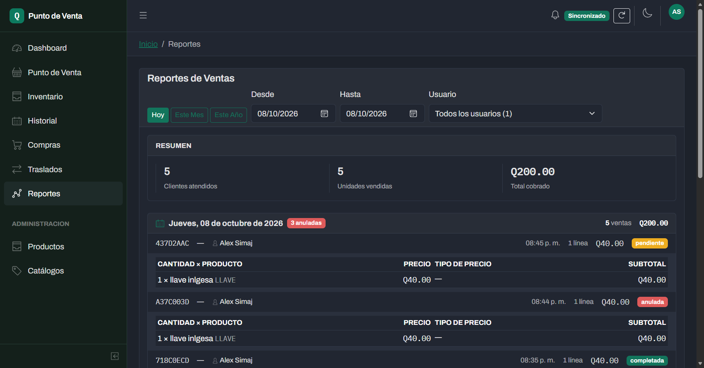

### CP-REP-002 — Cambio de preset de fecha

| CAMPO | CONTENIDO |
| --- | --- |
| ID del caso de prueba | CP-REP-002 |
| Escenario de prueba | Cambio de preset de fecha |
| Pasos de la prueba | 1. Ir a #/reportes (preset "Hoy"). 2. Clic en "Este Mes". 3. Revisar rango, tarjetas y listado. 4. Clic en "Este Año". 5. Revisar rango, tarjetas y listado |
| Requisitos previos | Ventas registradas en el mes y en el año de la sucursal activa |
| Datos de prueba | Presets "Hoy" (desde=hasta=hoy), "Este Mes" (desde=primer día del mes, hasta=hoy) y "Este Año" (desde=01-01 del año, hasta=hoy) |
| Resultados esperados/previstos | Cada preset actualiza los inputs "Desde"/"Hasta", deja su botón sólido (los demás en outline) y recalcula tarjetas y listado; el total del período crece al ampliar el rango (coincidencia Este Mes = Este Año solo si todas las ventas del año caen en el mes en curso) |
| Resultados reales | Hoy [2026-10-08..2026-10-08]: 5 clientes, 5 unidades, Q200.00, 8 bloque(s) → Este Mes [2026-10-01..2026-10-08]: 9 clientes, 9 unidades, Q350.00, 13 bloque(s) → Este Año [2026-01-01..2026-10-08]: 9 clientes, 9 unidades, Q350.00, 13 bloque(s). Rango y preset cambiaron en ambos pasos. Este Mes y Este Año coinciden porque todas las ventas del año caen en el mes en curso |
| Estado de la prueba: Aprobado/Reprobado | **Aprobado** |

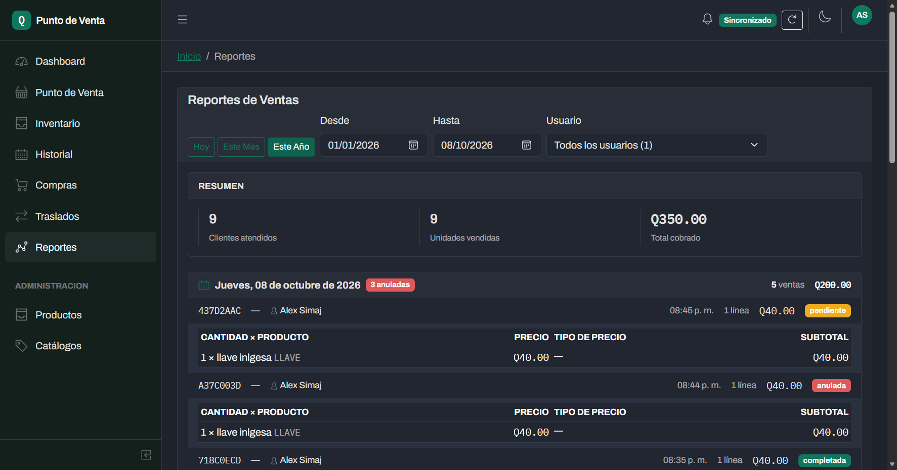

### CP-REP-003 — Rango de fechas manual

| CAMPO | CONTENIDO |
| --- | --- |
| ID del caso de prueba | CP-REP-003 |
| Escenario de prueba | Rango de fechas manual |
| Pasos de la prueba | 1. Ir a #/reportes. 2. Clic en "Este Mes". 3. Editar el input "Desde" (data-testid input-desde) al primer día del mes anterior. 4. Editar el input "Hasta" (data-testid input-hasta) al último día del mes anterior. 5. Revisar el resaltado de los presets y el listado |
| Requisitos previos | Reporte abierto con un preset activo y ventas en el mes en curso |
| Datos de prueba | Rango manual: Desde = 01 del mes anterior y Hasta = último día de ese mes (mes anterior sin ventas); el preset activo debía ser "Este Mes" |
| Resultados esperados/previstos | Al editar cualquier input el preset activo se desactiva (los tres botones quedan en outline) y el listado se refiltra por el rango elegido (de N ventas a "No hay ventas en el período seleccionado" con tarjetas en 0) |
| Resultados reales | preset "Este Mes" activo con 13 bloque(s) → editar "Desde" a 2026-09-01 desactiva los 3 presets (todos outline) y conserva 13 bloque(s) → editar "Hasta" a 2026-09-30 deja el rango 2026-09-01..2026-09-30 sin ventas: mensaje "No hay ventas en el período seleccionado", tarjetas 0/0/Q0.00, sin alertas (0 visibles) |
| Estado de la prueba: Aprobado/Reprobado | **Aprobado** |

### CP-REP-004 — Filtrado por usuario

| CAMPO | CONTENIDO |
| --- | --- |
| ID del caso de prueba | CP-REP-004 |
| Escenario de prueba | Filtrado por usuario |
| Pasos de la prueba | 1. Ir a #/reportes y elegir el preset "Este Mes". 2. Revisar las opciones del select "Usuario". 3. Seleccionar el usuario disponible. 4. Verificar que solo se listen sus ventas. 5. Volver a "Todos los usuarios (N)" |
| Requisitos previos | Ventas en el período con el campo usuario resuelto (el select solo ofrece a quien vendió en el rango) |
| Datos de prueba | Select "Usuario" con la opción "Todos los usuarios (N)" y un elemento por vendedor del período (por defecto "Alex Simaj"); el listado completo se restaura con la opción vacía |
| Resultados esperados/previstos | Con un usuario seleccionado solo se muestran sus bloques de venta; al elegir "Todos los usuarios (N)" vuelve el listado completo con el mismo número de bloques |
| Resultados reales | select "Usuario" con 2 opción(es) (Todos los usuarios (1)); filtrar por "Alex Simaj" → 13 de 13 bloque(s), todos con ese vendedor; volver a "Todos los usuarios (1)" → 13 bloque(s) con 9 cliente(s) y Q350.00 cobrados (listado completo restaurado) |
| Estado de la prueba: Aprobado/Reprobado | **Aprobado** |

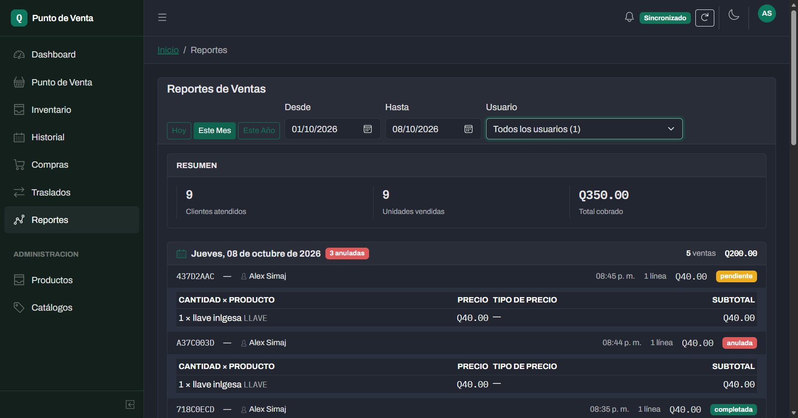

### CP-REP-005 — Detalle de productos por venta

| CAMPO | CONTENIDO |
| --- | --- |
| ID del caso de prueba | CP-REP-005 |
| Escenario de prueba | Detalle de productos por venta |
| Pasos de la prueba | 1. Ir a #/reportes y elegir "Este Mes". 2. Revisar el primer bloque de venta (data-testid venta-bloque): id, cliente, usuario, hora, "N líneas", total y badge de estado. 3. Revisar la tabla inferior de productos (data-testid venta-lineas / tabla-lineas). 4. Revisar el pie del listado |
| Requisitos previos | Ventas con detalle de líneas disponible en el período |
| Datos de prueba | Bloque de venta con data-testid venta-bloque y venta-cliente; tabla con columnas "Cantidad × Producto", "Precio", "Tipo de precio" y "Subtotal"; pie con data-testid pie-reportes |
| Resultados esperados/previstos | Cada venta muestra cliente, usuario, hora, "N líneas", total en Q y badge de estado (completada/anulada/pendiente); la tabla lista las 4 columnas con al menos una línea de producto; el pie indica "N ventas en el período · detalle de productos visible en cada venta" |
| Resultados reales | bloque 437D2AAC → cliente "—", usuario "Alex Simaj", hora 08:45 p. m., 1 línea, total Q40.00, badge "pendiente" · tabla con columnas [Cantidad × Producto, Precio, Tipo de precio, Subtotal] y 1 línea(s) de producto (fila: ["1 × llave inlgesa LLAVE","Q40.00","—","Q40.00"]) · 13 tabla(s) en pantalla · pie "13 ventas en el período · detalle de productos visible en cada venta" |
| Estado de la prueba: Aprobado/Reprobado | **Aprobado** |

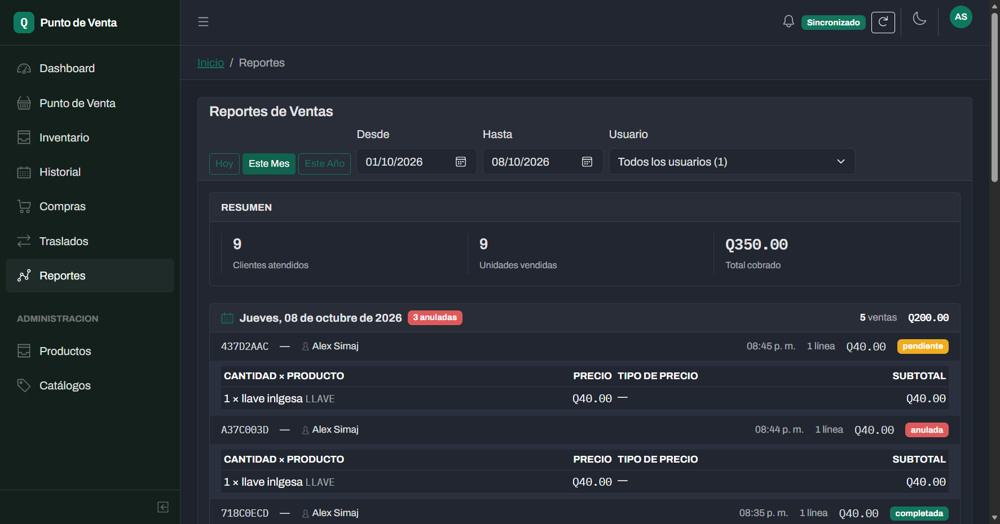

### CP-REP-006 — Período sin ventas

| CAMPO | CONTENIDO |
| --- | --- |
| ID del caso de prueba | CP-REP-006 |
| Escenario de prueba | Período sin ventas |
| Pasos de la prueba | 1. Ir a #/reportes. 2. Editar "Desde" a 2020-01-01. 3. Editar "Hasta" a 2020-01-31. 4. Revisar tarjetas, listado y alertas |
| Requisitos previos | Ninguno (rango histórico sin actividad) |
| Datos de prueba | Rango manual 2020-01-01 .. 2020-01-31; los tres presets quedan desactivados |
| Resultados esperados/previstos | Tarjetas en 0 (0 clientes, 0 unidades, Q0.00) con el mensaje "No hay ventas en el período seleccionado", sin alertas de error y sin excepciones en consola |
| Resultados reales | rango 2020-01-01..2020-01-31 con los 3 presets en outline → "No hay ventas en el período seleccionado", tarjetas Clientes 0 / Unidades 0 / Total Q0.00, 0 bloques y 0 grupos, sin alertas de error |
| Estado de la prueba: Aprobado/Reprobado | **Aprobado** |

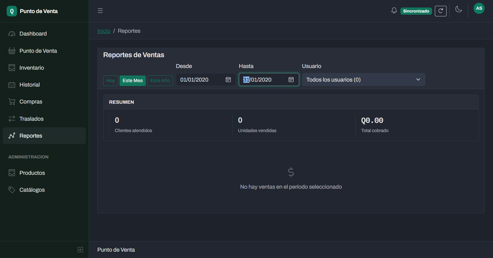

### CP-REP-007 — Reportes sin conexión

| CAMPO | CONTENIDO |
| --- | --- |
| ID del caso de prueba | CP-REP-007 |
| Escenario de prueba | Reportes sin conexión |
| Pasos de la prueba | 1. Abrir #/reportes con red (calienta el chunk lazy). 2. Cortar la red por CDP. 3. Volver a entrar a #/reportes. 4. Revisar la alerta, el listado local y que la vista no quede en blanco. 5. Restaurar la red |
| Requisitos previos | Ruta #/reportes ya cargada con red (regla del repo: sin red un import dinámico frío revienta); IndexedDB de la sucursal disponible |
| Datos de prueba | Red cortada con Network.emulateNetworkConditions offline=true (navigator.onLine=false); se restaura en el finally de este caso |
| Resultados esperados/previstos | La vista renderiza en #/reportes sin quedar en blanco ni quedarse en spinner; se informa el origen de los datos (locales) y, si procede, la alerta "Sin respuesta del servidor, se muestran solo las ventas locales: ..." junto con el aviso de folio sin red en el detalle |
| Resultados reales | navigator.onLine=false con #/reportes ya abierto con red → re-navegar renderizó #/reportes con título "Reportes de Ventas" y card "Resumen" (0 clientes, 0 unidades, Q0.00) · "No hay ventas en el período seleccionado" (el espejo local no tiene ventas para el rango) · sin alerta "Sin respuesta del servidor…" (ReportesPage solo llama al RPC cuando useEstadoRed=true; con navigator.onLine=false se salta el servidor y no hay error que reportar) · 0 alerta(s) en pantalla ([]) · la vista no quedó en blanco ni en spinner; con red el período mostraba 8 bloque(s) y Q200.00 |
| Estado de la prueba: Aprobado/Reprobado | **Aprobado** |

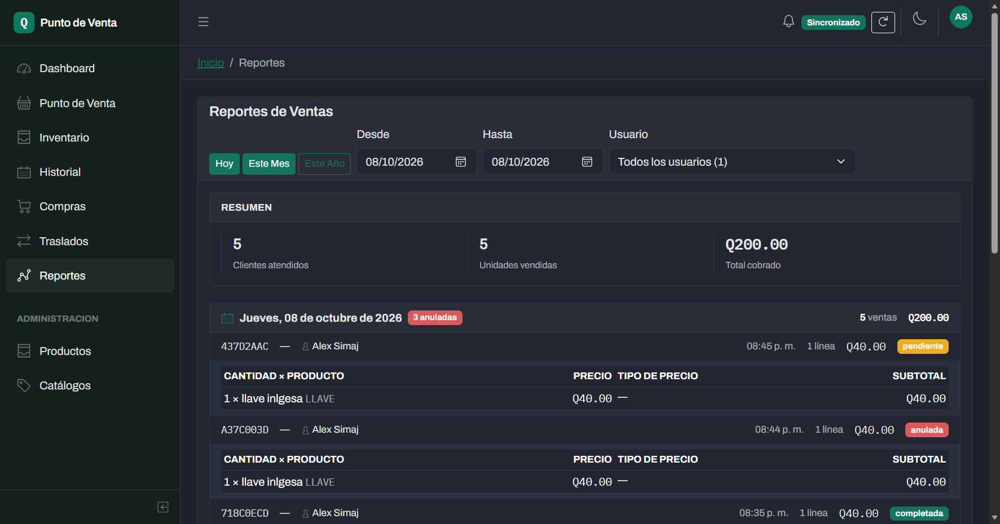

### CP-REP-008 — Acceso sin permiso de ver

| CAMPO | CONTENIDO |
| --- | --- |
| ID del caso de prueba | CP-REP-008 |
| Escenario de prueba | Acceso sin permiso de ver |
| Pasos de la prueba | 1. Con red, quitar reportes/ver al rol Gerente (permiso temporal). 2. Ir a #/dashboard. 3. Intentar entrar a #/reportes. 4. Verificar la URL final y que la vista no se renderice (el permiso se restaura solo) |
| Requisitos previos | Red disponible (permisoService re-consulta has_permission con red y cachea el resultado); existe el permiso reportes del rol Gerente |
| Datos de prueba | Rol Gerente 3cf414b4-156f-40d2-a6a2-715ad8113283 con reportes/ver=false temporal; restaurado en el finally de permisoTemporal |
| Resultados esperados/previstos | Tras validar el permiso el sistema redirige a #/dashboard sin renderizar "Reportes de Ventas" |
| Resultados reales | desde #/dashboard → intento de #/reportes con reportes/ver=false redirigió a #/dashboard sin renderizar "Reportes de Ventas"; permiso restaurado por permisoTemporal (original {"ver":true,"crear":true,"editar":true,"eliminar":true}) |
| Estado de la prueba: Aprobado/Reprobado | **Aprobado** |

## Productos

### CP-PROD-001 — Crear un producto nuevo

| CAMPO | CONTENIDO |
| --- | --- |
| ID del caso de prueba | CP-PROD-001 |
| Escenario de prueba | Crear un producto nuevo |
| Pasos de la prueba | 1. Ir a #/productos. 2. Clic en "+ Producto". 3. Completar "Nombre *" (único), SKU, precio compra e precio inicial Normal. 4. Clic en "Crear Producto" |
| Requisitos previos | Usuario con permiso productos/crear; empresa activa; red disponible; tipos de precio MAYOREO y NORMAL existentes |
| Datos de prueba | alex/alex123 (Gerente, Ferromax chichi); nombre "Producto E2E CP", SKU "CP-E2E-001", precio compra 50 (Q50.00), precio inicial Normal 100 (Q100.00), estado por defecto disponible |
| Resultados esperados/previstos | Toast "Producto creado"; el producto aparece en la tabla con su precio (Q100.00), costo (Q50.00), margen y stock |
| Resultados reales | toast "Éxito Producto creado"; fila creada: producto "Producto E2E CP · CP-E2E-001 · disponible", Precio Q100.00, Costo Q50.00, Margen 50%, Stock 0 |
| Estado de la prueba: Aprobado/Reprobado | **Aprobado** |

### CP-PROD-002 — Editar un producto existente

| CAMPO | CONTENIDO |
| --- | --- |
| ID del caso de prueba | CP-PROD-002 |
| Escenario de prueba | Editar un producto existente |
| Pasos de la prueba | 1. Ir a #/productos. 2. Clic en "Editar" del producto creado. 3. Modificar descripción y estado (a agotado). 4. Clic en "Guardar Cambios". 5. Reabrir "Editar" para verificar la descripción persistida |
| Requisitos previos | Producto existente con permiso productos/editar |
| Datos de prueba | Producto "Producto E2E CP" (creado en CP-PROD-001); descripción → "Editado por E2E CP-PROD-002"; estado → agotado |
| Resultados esperados/previstos | Toast "Producto editado"; los cambios se reflejan en la tabla (estado "agotado") y la descripción persiste al reabrir el modal |
| Resultados reales | toast "Éxito Producto editado"; estado en tabla "agotado"; descripción persiste al reabrir el modal ("Editado por E2E CP-PROD-002") |
| Estado de la prueba: Aprobado/Reprobado | **Aprobado** |

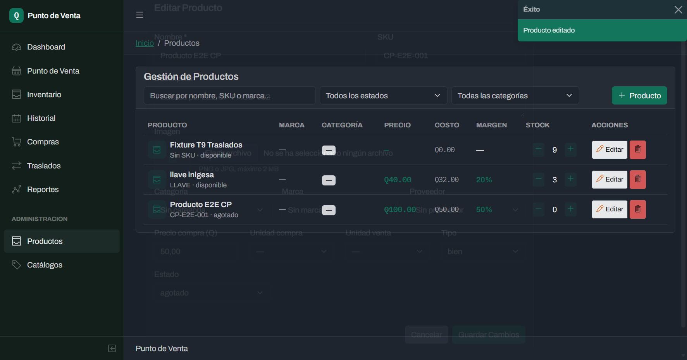

### CP-PROD-003 — Eliminar un producto con confirmación

| CAMPO | CONTENIDO |
| --- | --- |
| ID del caso de prueba | CP-PROD-003 |
| Escenario de prueba | Eliminar un producto con confirmación |
| Pasos de la prueba | 1. Ir a #/productos. 2. Clic en el ícono de papelera de la fila del producto. 3. Revisar "Confirmar eliminación". 4. Clic en "Eliminar" |
| Requisitos previos | Producto existente con permiso productos/eliminar |
| Datos de prueba | Producto "Producto E2E CP" en la tabla; ConfirmModal "Confirmar eliminación" con mensaje ¿Eliminar el producto "Producto E2E CP"? Esta acción no se puede deshacer. |
| Resultados esperados/previstos | Mensaje de confirmación correcto; toast "Producto eliminado"; desaparece de la tabla y del servidor (verificación REST al finalizar la suite) |
| Resultados reales | ConfirmModal "Confirmar eliminación" con mensaje exacto; toast "Éxito Producto eliminado"; el producto desapareció de la tabla (visible=false) y del servidor (REST get_productos_admin: 0 coincidencias) |
| Estado de la prueba: Aprobado/Reprobado | **Aprobado** |

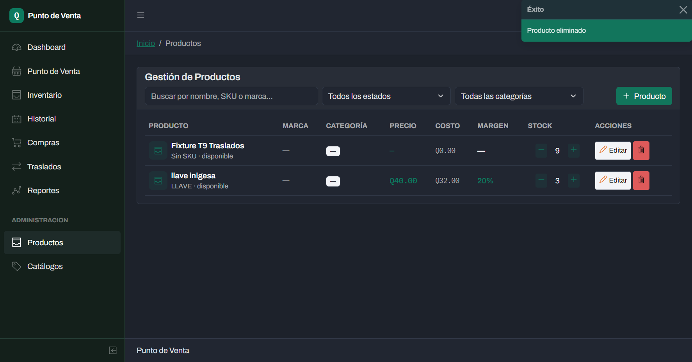

### CP-PROD-004 — Crear producto sin nombre

| CAMPO | CONTENIDO |
| --- | --- |
| ID del caso de prueba | CP-PROD-004 |
| Escenario de prueba | Crear producto sin nombre |
| Pasos de la prueba | 1. Ir a #/productos. 2. Clic en "+ Producto". 3. Dejar "Nombre *" vacío. 4. Clic en "Crear Producto" |
| Requisitos previos | Modal "Nuevo Producto" abierto |
| Datos de prueba | Modal "Nuevo Producto" con "Nombre *" vacío; botón "Crear Producto" |
| Resultados esperados/previstos | El campo "Nombre *" es obligatorio (required nativo); el formulario no se envía, el modal permanece abierto y no se crea ningún producto |
| Resultados reales | al clickear "Crear Producto" con nombre vacío: el navegador bloqueó el envío (required nativo, checkValidity=false, validationMessage="Rellene este campo."), el modal permaneció abierto y no apareció toast de creación; el formulario no se envió |
| Estado de la prueba: Aprobado/Reprobado | **Aprobado** |

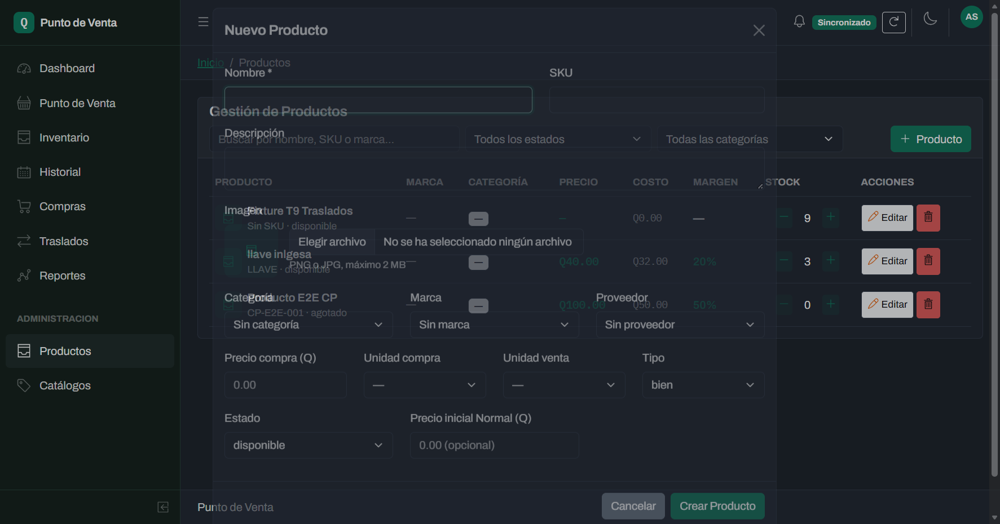

### CP-PROD-005 — Imagen inválida o mayor a 2 MB

| CAMPO | CONTENIDO |
| --- | --- |
| ID del caso de prueba | CP-PROD-005 |
| Escenario de prueba | Imagen inválida o mayor a 2 MB |
| Pasos de la prueba | 1. Abrir el modal de producto. 2. Adjuntar un .txt (no imagen). 3. Adjuntar un .png de 2.5 MB. 4. Cancelar el modal. 5. Borrar los temporales |
| Requisitos previos | Modal de producto abierto; input file "Imagen" con leyenda "PNG o JPG, máximo 2 MB" |
| Datos de prueba | Temporales: no-imagen.txt (texto plano) y grande.png (2.5 MB con firma PNG válida); límite MAX_BYTES = 2 MB |
| Resultados esperados/previstos | Errores "El archivo debe ser una imagen" y "La imagen no puede superar 2 MB"; no se guarda el archivo; el modal se puede cancelar |
| Resultados reales | archivos: no-imagen.txt → toast "Error El archivo debe ser una imagen"; grande.png (2.5 MB, firma PNG) → toast "Error La imagen no puede superar 2 MB"; el input file quedó limpio (value=""), el modal no guardó nada y se canceló; temporales borrados |
| Estado de la prueba: Aprobado/Reprobado | **Aprobado** |

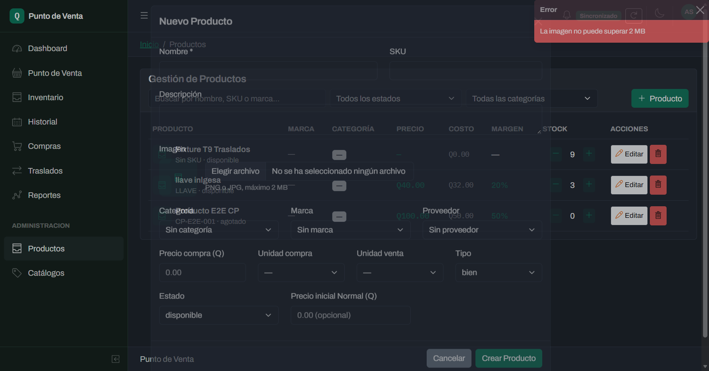

### CP-PROD-006 — Gestión de precios por tipo y cantidad

| CAMPO | CONTENIDO |
| --- | --- |
| ID del caso de prueba | CP-PROD-006 |
| Escenario de prueba | Gestión de precios por tipo y cantidad |
| Pasos de la prueba | 1. Clic en el precio verde de la fila (title "Clic para editar precios"). 2. En "Precios — {nombre}" agregar MAYOREO desde 5 a Q80.00. 3. Editar ese tier a Q75.00 ("Actualizar"). 4. Eliminar solo el tier MAYOREO creado (el tier NORMAL inicial se conserva) |
| Requisitos previos | Producto creado con precio inicial Normal (tier NORMAL desde 1); tipos de precio MAYOREO y NORMAL existentes |
| Datos de prueba | Producto "Producto E2E CP" con tier NORMAL Q100.00 (desde 1); tier MAYOREO temporal: desde 5, precio Q80.00 → se actualiza a Q75.00 → se elimina al final del caso |
| Resultados esperados/previstos | Toasts "Precio agregado", "Precio actualizado" y "Precio eliminado"; la fila muestra el precio NORMAL sin alteraciones tras limpiar el tier creado |
| Resultados reales | toasts "Éxito Precio agregado" → "Éxito Precio actualizado" → "Éxito Precio eliminado"; tier MAYOREO agregado (desde 5, Q80.00), actualizado (Q75.00) y eliminado; solo queda el tier NORMAL inicial y la fila muestra Precio Q100.00 |
| Estado de la prueba: Aprobado/Reprobado | **Aprobado** |

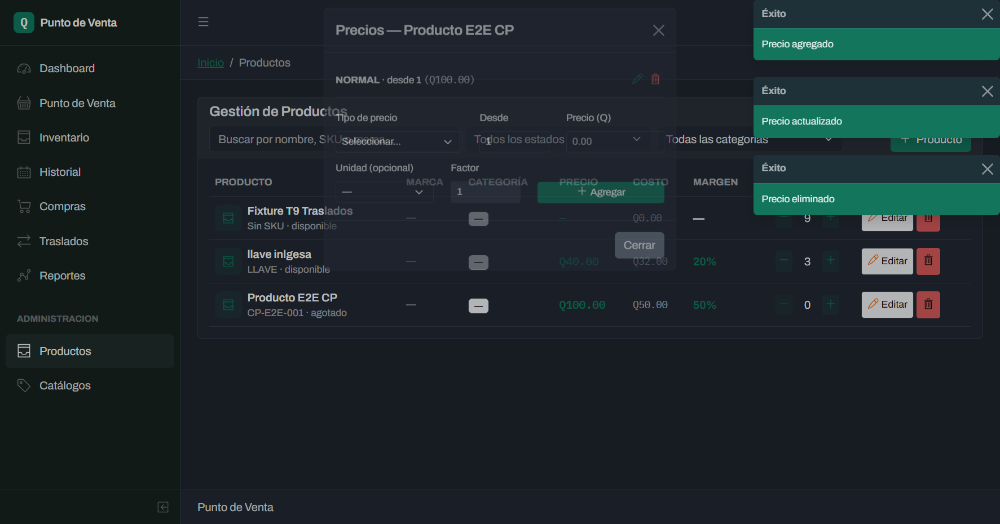

### CP-PROD-007 — Edición de stock por sucursal

| CAMPO | CONTENIDO |
| --- | --- |
| ID del caso de prueba | CP-PROD-007 |
| Escenario de prueba | Edición de stock por sucursal |
| Pasos de la prueba | 1. Clic en el número de Stock de la fila. 2. En "Stock — {nombre}" revisar columnas Sucursal/Stock/Mínimo. 3. Ajustar el Mínimo de la primera sucursal a 1. 4. Clic en "Guardar Stock" |
| Requisitos previos | Producto con stock en la sucursal actual y permiso productos/editar; red disponible (el modal escribe por RPC) |
| Datos de prueba | Producto "Producto E2E CP" con stock 0; se cambia Mínimo de la primera sucursal listada (Ferromax chichi) de 0 a 1; el cambio se anota y queda neutralizado con la baja del producto en CP-PROD-003 |
| Resultados esperados/previstos | Tabla por sucursal con columnas Sucursal, Stock y Mínimo; toast "Stock guardado"; el modal se cierra |
| Resultados reales | 2 sucursal(es) listadas (Ferromax chichi: stock 0, mín 0 \| Ferromax quiche: stock 0, mín 0); Mínimo de "Ferromax chichi" 0 → 1; toast "Éxito Stock guardado"; nota: el producto se elimina en CP-PROD-003, lo que retira sus filas de stock |
| Estado de la prueba: Aprobado/Reprobado | **Aprobado** |

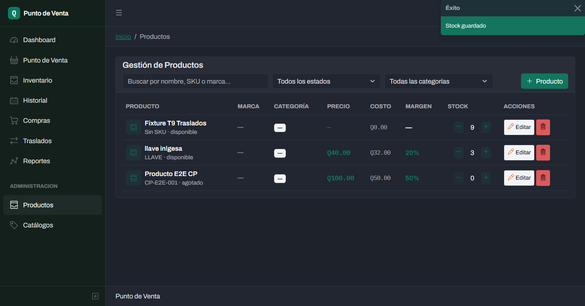

### CP-PROD-008 — Filtros de búsqueda, estado y categoría

| CAMPO | CONTENIDO |
| --- | --- |
| ID del caso de prueba | CP-PROD-008 |
| Escenario de prueba | Filtros de búsqueda, estado y categoría |
| Pasos de la prueba | 1. Ir a #/productos. 2. Buscar "llave", luego "CP-E2E", luego basura ("zzqqxx@@"). 3. Filtrar por "Disponible" y por "Agotado". 4. Revisar el select de categorías |
| Requisitos previos | Productos con distintos estados (Producto E2E CP queda agotado tras CP-PROD-002); empresa sin categorías registradas |
| Datos de prueba | Términos válidos: "llave" (nombre) y "CP-E2E" (SKU del producto E2E); término sin coincidencias: "zzqqxx@@"; estados disponibles/agotado |
| Resultados esperados/previstos | Cada filtro reduce la tabla; sin coincidencias se muestra "No hay productos"; el select de categorías solo ofrece "Todas las categorías" (catálogo vacío) |
| Resultados reales | busqueda "llave" → 1 fila; "CP-E2E" → 1 fila ("Producto E2E CP"); "zzqqxx@@" → 0 filas con "No hay productos"; limpiar → 3 filas; estado "Disponible" → 2 fila(s) sin el producto E2E; estado "Agotado" → 1 fila (solo el producto E2E); el select de categorías solo contiene "Todas las categorías" (empresa sin categorías registradas: "Todas las categorías"); no se pudo filtrar de verdad — registrado honestamente |
| Estado de la prueba: Aprobado/Reprobado | **Aprobado** |

### CP-PROD-009 — Ocultación del botón de creación sin permiso

| CAMPO | CONTENIDO |
| --- | --- |
| ID del caso de prueba | CP-PROD-009 |
| Escenario de prueba | Ocultación del botón de creación sin permiso |
| Pasos de la prueba | 1. Con red, quitar productos/crear al rol Gerente (permiso temporal). 2. Navegar a #/dashboard y luego a #/productos (re-montaje fuerza la re-consulta). 3. Verificar que "+ Producto" desaparece y "Editar" sigue. 4. Verificar que al restaurar el permiso el botón regresa |
| Requisitos previos | Red disponible (permisoService re-consulta has_permission con red y cachea el resultado) |
| Datos de prueba | Rol Gerente 3cf414b4-156f-40d2-a6a2-715ad8113283 con productos/crear=false temporal; restaurado en el finally de permisoTemporal |
| Resultados esperados/previstos | El botón "+ Producto" no está visible sin permiso crear; las acciones de edición siguen sus permisos; al restaurar, el botón vuelve |
| Resultados reales | con productos/crear=false: desde #/dashboard → #/productos con 0 botón(es) en el card-header ("+ Producto" oculto) y 3 botón(es) "Editar" visibles; al restaurar el permiso el botón regresó (1); permiso restaurado por permisoTemporal |
| Estado de la prueba: Aprobado/Reprobado | **Aprobado** |

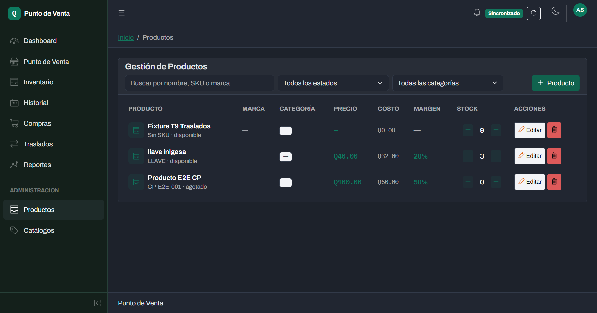

### CP-PROD-010 — Productos sin conexión

| CAMPO | CONTENIDO |
| --- | --- |
| ID del caso de prueba | CP-PROD-010 |
| Escenario de prueba | Productos sin conexión |
| Pasos de la prueba | 1. Abrir #/productos con red (calienta el chunk lazy). 2. Cortar la red por CDP. 3. Volver a entrar a #/productos. 4. Comparar con con red. 5. Restaurar la red |
| Requisitos previos | Catálogo hidratado en IndexedDB y chunk lazy de la ruta ya cargado con red (sin red un import dinámico frío revienta) |
| Datos de prueba | Red cortada con Network.emulateNetworkConditions offline=true; datos locales de Ferromax en IndexedDB |
| Resultados esperados/previstos | Aparece la alerta "Sin conexión. Productos desde almacenamiento local — solo lectura."; se listan los datos de IndexedDB sin bloquearse; al restaurar la red la alerta desaparece |
| Resultados reales | red cortada (navigator.onLine=false) → #/productos mostró la alerta offline y 2 fila(s) desde IndexedDB: ["Fixture T9 Traslados Sin SKU · disponible — — — Q0.00 — 9 Editar","llave inlgesa LLAVE · disponible — — Q40.00 Q32.00 20% 3 Editar"]; el producto E2E creado por RPC posterior a la hidratación NO figura en el espejo local (esperado: NO, la hidratación ocurre en login); vista sin bloqueo |
| Estado de la prueba: Aprobado/Reprobado | **Aprobado** |

## Catálogos

### CP-CAT-001 — Crear un registro en un catálogo

| CAMPO | CONTENIDO |
| --- | --- |
| ID del caso de prueba | CP-CAT-001 |
| Escenario de prueba | Crear un registro en un catálogo |
| Pasos de la prueba | 1. Ir a #/catalogos. 2. Verificar la pestaña "Marcas". 3. Clic en el botón de crear ("+ Marca"). 4. Escribir "Nombre *" = "Marca E2E CP". 5. Clic en "Crear" |
| Requisitos previos | Usuario con permiso catalogos/crear; red disponible; empresa activa con el catálogo Marcas vacío |
| Datos de prueba | Usuario alex/alex123 (Gerente, Ferromax); nombre de prueba "Marca E2E CP" (se elimina en CP-CAT-003 y se repasa en el finally) |
| Resultados esperados/previstos | Toast "Marca creada"; el registro aparece en la lista de tarjetas y el modal se cierra |
| Resultados reales | Modal "Nueva Marca" · "Nombre *" = "Marca E2E CP" · "Crear" → toast "Éxito Marca creada" · tarjeta visible con texto "Marca E2E CP" |
| Estado de la prueba: Aprobado/Reprobado | **Aprobado** |

### CP-CAT-002 — Editar un registro existente

| CAMPO | CONTENIDO |
| --- | --- |
| ID del caso de prueba | CP-CAT-002 |
| Escenario de prueba | Editar un registro existente |
| Pasos de la prueba | 1. Ir a #/catalogos. 2. Clic en "Editar" (title) de la tarjeta "Marca E2E CP". 3. Cambiar "Nombre *" a "Marca E2E CP 2". 4. Clic en "Guardar Cambios" |
| Requisitos previos | Registro "Marca E2E CP" creado por CP-CAT-001 y permiso catalogos/editar con red |
| Datos de prueba | Nombre original "Marca E2E CP" (el modal debe abrir precargado con ese valor); nombre nuevo "Marca E2E CP 2" |
| Resultados esperados/previstos | Toast "Guardado correctamente"; la tarjeta muestra "Marca E2E CP 2" y ya no aparece "Marca E2E CP" |
| Resultados reales | Modal "Editar Marca" precargado con "Marca E2E CP" → "Marca E2E CP 2" · "Guardar Cambios" → toast "Éxito Guardado correctamente" · tarjeta actualizada y nombre viejo ausente |
| Estado de la prueba: Aprobado/Reprobado | **Aprobado** |

### CP-CAT-003 — Eliminar un registro con confirmación

| CAMPO | CONTENIDO |
| --- | --- |
| ID del caso de prueba | CP-CAT-003 |
| Escenario de prueba | Eliminar un registro con confirmación |
| Pasos de la prueba | 1. Clic en "Eliminar" (title) de la tarjeta "Marca E2E CP 2". 2. Revisar el mensaje del modal de confirmación. 3. Clic en "Eliminar". 4. Repetir para "Proveedor E2E CAT" y "Unidad E2E CP" si llegaron a crearse |
| Requisitos previos | Registros de prueba creados por la propia suite; permiso catalogos/eliminar; red disponible |
| Datos de prueba | A borrar: "Marca E2E CP 2", "Proveedor E2E CAT" (cp@prueba.com) y "Unidad E2E CP" (E2E); no se tocan "Unidad"/UNI ni MAYOREO/NORMAL |
| Resultados esperados/previstos | Mensaje "¿Eliminar "X"? Esta acción no se puede deshacer."; toast "Registro eliminado"; la tarjeta desaparece de la lista |
| Resultados reales | Confirmación exacta "¿Eliminar "Marca E2E CP 2"? Esta acción no se puede deshacer." → toast "Éxito Registro eliminado" y tarjeta desaparecida (1 pasada) · Proveedor E2E CAT: eliminada en 1 pasada(s) · Unidad E2E CP: eliminada en 1 pasada(s) · verificado contra el servidor: sin registros de prueba |
| Estado de la prueba: Aprobado/Reprobado | **Aprobado** |

### CP-CAT-004 — Navegación entre los 5 catálogos

| CAMPO | CONTENIDO |
| --- | --- |
| ID del caso de prueba | CP-CAT-004 |
| Escenario de prueba | Navegación entre los 5 catálogos |
| Pasos de la prueba | 1. Ir a #/catalogos. 2. Confirmar que la pestaña inicial es "Marcas". 3. Recorrer Marcas, Categorías, Proveedores, Unidades y Tipos de Precio. 4. En cada una revisar el título, el botón de creación y el contenido |
| Requisitos previos | Sesión con empresa activa y catálogos de la empresa cargados desde el servidor (red disponible) |
| Datos de prueba | Estado real de Ferromax al inicio: Marcas 0, Categorías 0, Proveedores 0 (o 1 con el residual "Proveedor E2E CP" que deja la suite Compras), Unidades 1 ("Unidad"/UNI/Activa), Tipos de Precio MAYOREO y NORMAL |
| Resultados esperados/previstos | Cada pestaña muestra su botón con el nombre correcto ("Marca", "Categoría", "Proveedor", "Unidad", "Tipo de Precio", con ícono "+"); las listas vacías muestran "Crea el primer registro con el botón «X»." y las no vacías sus registros; pestaña inicial: Marcas |
| Resultados reales | Pestaña inicial "Marcas"; 5 pestañas recorridas · Marcas: vacía + botón "Marca" · Categorías: vacía + botón "Categoría" · Proveedores: botón "Proveedor" + 2 registro(s) (Proveedor E2E CP, Proveedor E2E CP) · Unidades: botón "Unidad" + 1 registro(s) (Unidad) · Tipos de Precio: botón "Tipo de Precio" + 2 registro(s) (MAYOREO, NORMAL) · Unidades/badges: "Unidad UNI Activa" |
| Estado de la prueba: Aprobado/Reprobado | **Aprobado** |

### CP-CAT-005 — Crear registro sin nombre

| CAMPO | CONTENIDO |
| --- | --- |
| ID del caso de prueba | CP-CAT-005 |
| Escenario de prueba | Crear registro sin nombre |
| Pasos de la prueba | 1. Ir a #/catalogos. 2. Clic en el botón de crear. 3. Dejar "Nombre *" vacío. 4. Intentar guardar con "Crear". 5. Clic en "Cancelar" |
| Requisitos previos | Modal "Nueva Marca" abierto con el campo "Nombre *" vacío |
| Datos de prueba | Campo "Nombre *" con atributo required nativo; botón "Crear" (type=submit) |
| Resultados esperados/previstos | El campo "Nombre *" es obligatorio: la validación nativa del navegador bloquea el envío, el modal sigue abierto y no se crea ningún registro |
| Resultados reales | Campo "Nombre *" required=true y vacío → clic en "Crear" bloqueado por validación nativa (checkValidity=false), modal abierto, 0 toasts y marcas sin cambios (1); cerrado con "Cancelar" |
| Estado de la prueba: Aprobado/Reprobado | **Aprobado** |

### CP-CAT-006 — Correo inválido en proveedor

| CAMPO | CONTENIDO |
| --- | --- |
| ID del caso de prueba | CP-CAT-006 |
| Escenario de prueba | Correo inválido en proveedor |
| Pasos de la prueba | 1. Ir a la pestaña "Proveedores". 2. Clic en "+ Proveedor". 3. Escribir nombre "Proveedor E2E CAT" y correo "no-es-correo". 4. Intentar guardar. 5. Corregir el correo a "cp@prueba.com" y volver a guardar |
| Requisitos previos | Permiso catalogos/crear con red (la pestaña puede tener el proveedor residual de la suite Compras) |
| Datos de prueba | Correo inválido "no-es-correo" (input type=email) y correo válido "cp@prueba.com"; el registro creado se elimina en la limpieza |
| Resultados esperados/previstos | El input "Correo" (type email) bloquea el envío con correo inválido (el modal no se cierra); con correo válido se guarda con datos de contacto (address · email · tel) y toast "Proveedor creada" |
| Resultados reales | Modal "Nueva Proveedor" con campos Dirección/Correo(type=email)/Teléfono · hallazgo: la app titula "Nueva Proveedor" y docs/casos-prueba-usuario.md (CP-CAT-006) lo llama "Nuevo Proveedor" · correo "no-es-correo" → checkValidity=false, modal abierto, 0 toasts, proveedores sin cambios (2) → correo "cp@prueba.com" → toast "Éxito Proveedor creada" y tarjeta "Proveedor E2E CAT cp@prueba.com" (registro eliminado en la limpieza) |
| Estado de la prueba: Aprobado/Reprobado | **Aprobado** |

### CP-CAT-007 — Crear una unidad de medida

| CAMPO | CONTENIDO |
| --- | --- |
| ID del caso de prueba | CP-CAT-007 |
| Escenario de prueba | Crear una unidad de medida |
| Pasos de la prueba | 1. Ir a la pestaña "Unidades". 2. Clic en "+ Unidad". 3. Completar Nombre "Unidad E2E CP", Abreviatura "E2E", Equivalencia 1 y el switch "Activa". 4. Clic en "Crear" |
| Requisitos previos | Pestaña Unidades con la unidad "Unidad" y permiso catalogos/crear con red |
| Datos de prueba | Nombre "Unidad E2E CP", Abreviatura "E2E" (placeholder del campo: UNI), Equivalencia 1, switch "Activa" activado por defecto; se elimina en la limpieza |
| Resultados esperados/previstos | Toast "Unidad creada"; la tarjeta muestra el nombre con el badge de abreviatura "E2E" y el badge "Activa" |
| Resultados reales | Modal "Nueva Unidad" con Nombre="Unidad E2E CP", Abreviatura="E2E", Equivalencia=1 y switch "Activa" → toast "Éxito Unidad creada" · tarjeta "Unidad E2E CP E2E Activa" (unidad eliminada en la limpieza) |
| Estado de la prueba: Aprobado/Reprobado | **Aprobado** |

### CP-CAT-008 — Catálogos sin conexión

| CAMPO | CONTENIDO |
| --- | --- |
| ID del caso de prueba | CP-CAT-008 |
| Escenario de prueba | Catálogos sin conexión |
| Pasos de la prueba | 1. Abrir #/catalogos con red. 2. Abrir el modal de confirmación de "Unidad E2E CP". 3. Cortar la red. 4. Revisar la alerta. 5. Confirmar la eliminación sin red. 6. Abrir "Nueva Marca" con red, cortar la red y pulsar "Crear". 7. Recargar #/catalogos sin red. 8. Restaurar la red |
| Requisitos previos | #/catalogos ya abierto con red (chunk lazy caliente), IndexedDB hidratado y corte de red por CDP (Network.enable antes de emulateNetworkConditions) |
| Datos de prueba | Red cortada con Network.emulateNetworkConditions offline=true; nombre fantasma "Marca Fantasma CP" que NO debe guardarse; "Unidad E2E CP" como víctima del intento de borrado offline |
| Resultados esperados/previstos | Alerta "Sin conexión. Catálogos desde almacenamiento local — solo lectura."; guardar responde "Sin conexión: no se pueden guardar catálogos" y eliminar "No se pueden eliminar registros sin red"; ningún registro cambia |
| Resultados reales | red cortada por CDP (navigator.onLine=false) · confirmación con red: "¿Eliminar "Unidad E2E CP"? Esta acción no se puede deshacer." · alerta offline "Sin conexión. Catálogos desde almacenamiento local — solo lectura." y botón de crear oculto · eliminar sin red → toast "Sin conexión No se pueden eliminar registros sin red" · tras restaurar la red "Unidad E2E CP" sigue en el servidor · guardar sin red → toast "Error Sin conexión: no se pueden guardar catálogos" (modal abierto) · recarga sin red: alerta visible, botón oculto, mensaje local "No hay datos en el almacenamiento local." = sí · marcas intactas tras restaurar la red (1) |
| Estado de la prueba: Aprobado/Reprobado | **Aprobado** |

### CP-CAT-009 — Permisos de creación/edición/eliminación

| CAMPO | CONTENIDO |
| --- | --- |
| ID del caso de prueba | CP-CAT-009 |
| Escenario de prueba | Permisos de creación/edición/eliminación |
| Pasos de la prueba | 1. Con catalogos/crear=false (permiso temporal) recargar #/catalogos y revisar los 5 botones "+ ...". 2. Con catalogos/editar=false y catalogos/eliminar=false recargar y revisar los iconos de las tarjetas |
| Requisitos previos | Red disponible (permisoService re-consulta has_permission con red y cachea el resultado); permisoTemporal restaura el rol al salir |
| Datos de prueba | Rol Gerente 3cf414b4-156f-40d2-a6a2-715ad8113283 con catalogos/crear=false y luego editar=false y eliminar=false de forma temporal; estado base 4/4 |
| Resultados esperados/previstos | Los botones "+ ..." y los iconos Editar/Eliminar sin permiso no están visibles; el resto de la pestaña (título, pestañas y listado) se consulta normalmente |
| Resultados reales | crear=false: 5/5 pestañas sin botón "+ ..." (has_permission re-consultado=sí, listado operativo, errores de consola: 0) \| editar=false y eliminar=false: 0 iconos "Editar"/"Eliminar" en las tarjetas, botón "+ Marca" y listado siguen visibles (has_permission re-consultado=sí) |
| Estado de la prueba: Aprobado/Reprobado | **Aprobado** |

### CP-CAT-010 — Lista de catálogo vacía

| CAMPO | CONTENIDO |
| --- | --- |
| ID del caso de prueba | CP-CAT-010 |
| Escenario de prueba | Lista de catálogo vacía |
| Pasos de la prueba | 1. Ir a #/catalogos con red y el catálogo Marcas sin registros. 2. Revisar el mensaje de vacío y la consola |
| Requisitos previos | Catálogo Marcas vacío en el servidor y con red (offline mostraría "No hay datos en el almacenamiento local.") |
| Datos de prueba | Empresa Ferromax con marcas, categorías y proveedores vacíos al inicio de la suite (unidad "Unidad"/UNI y tipos MAYOREO/NORMAL sí existen) |
| Resultados esperados/previstos | Mensaje "Crea el primer registro con el botón «Marca»."; la pestaña inicial es Marcas; sin errores no capturados en consola |
| Resultados reales | Pestaña inicial "Marcas" · marcas en servidor: 0 · mensaje exacto "Crea el primer registro con el botón «Marca»." visible · sin errores no capturados en consola (window.onerror instalado tras el login) |
| Estado de la prueba: Aprobado/Reprobado | **Aprobado** |

